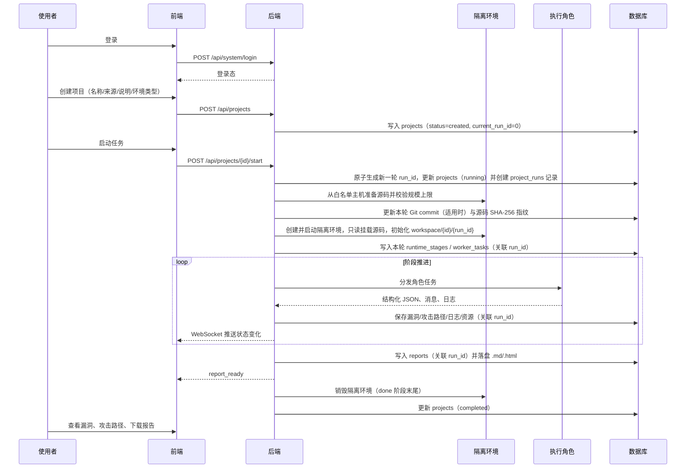
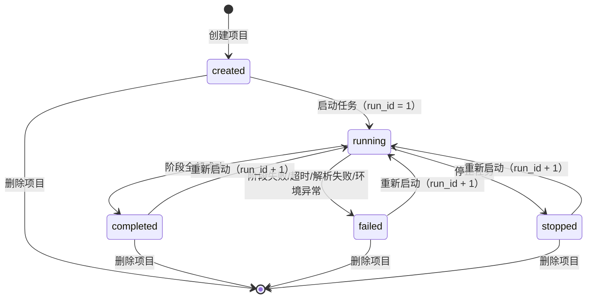
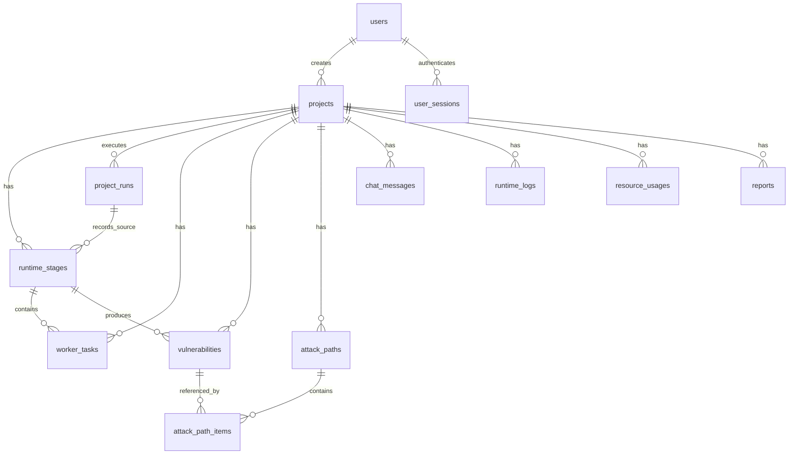

# 自动化安全评估系统 产品需求文档（PRD）

## 0. 文档信息

| 项目 | 内容 |
| --- | --- |
| 产品名称 | 自动化安全评估系统 |
| 文档版本 | v1.11 |
| 编写日期 | 2026-10-21 |
| 依据文档 | 《项目要求.md》第 2.5 节 |
| 文档状态 | 已冻结（v1.11） |
| 目标读者 | 产品、前端、后端、测试、运维、验收方 |

### 0.1 版本记录

| 版本 | 日期 | 修改说明 |
| --- | --- | --- |
| v1.0 | 2026-10-21 | 首次编写，覆盖 2.5.1 ~ 2.5.13 全部要求 |
| v1.1 | 2026-10-21 | 确认第 14 章 7 项技术决策，并同步至 1.3、1.4、3.2、5.2、5.4、5.5、5.6、5.8、5.10、11 |
| v1.2 | 2026-10-21 | 合并架构与安全评审意见：<br>1. 提升执行轮次 `run_id` 为 P0 并纳入全链路表结构与默认查询规则；<br>2. 补齐 `worker_tasks.error_message`、`vulnerabilities.impact_text/stage_id`、`projects` 环境与时间字段及 `system_configs` 表，修正 PostgreSQL 数据类型（`TIMESTAMPTZ` / `TEXT`）；<br>3. 明确攻击路径在阶段 3 由角色生成落库，明确阶段 5 先执行运维归档再销毁容器的时序；<br>4. 明确 `git_repo` 拉取时机与 `data/sources/{project_id}/` 存储及清理规则，收紧 `local_path` 白名单根目录与容器安全限额；<br>5. 统一隔离环境在各终态下的保留/销毁与重启生命周期，修正停止任务接口幂等规则，统一角色 JSON 解析失败重试与阶段阻断逻辑；<br>6. 补齐普通用户创建/预置方案、历史消息查询、退出登录、管理员环境清理与系统资源/日志接口，完善双格式报告路径规则与无漏洞验收标准。 |
| v1.3 | 2026-10-21 | 补充 Git 拉取主机白名单与网络目标校验、轮次级工作区和源码指纹、可重试的项目删除状态，以及可撤销的 JWT 会话；同步更新接口、数据模型和验收标准。 |
| v1.4 | 2026-10-21 | 固化实现契约：<br>1. 新增第 15 章（角色工具协议、执行循环、编号规则、编排运行时、容器执行通道、沙箱镜像与示例项目、报告渲染、模型接入）；<br>2. 新增附录 D 的 6 份 JSON Schema 与附录 E 环境变量清单；<br>3. `worker_tasks` 增加 `retry_count`，`vulnerabilities` 增加 `cvss_score`、`updated_at`，`reports` 增加唯一约束，明确 `runtime_logs` 轮次外键例外；<br>4. 新增 `/api/system/status`、`/api/system/health`、`/api/system/config/test-llm` 接口，修正用户启停接口的 P0/P1 标级；<br>5. 新增 `llm.max_turns`、`llm.thinking_enabled` 配置项，补充 AC-24、AC-25。 |
| v1.5 | 2026-10-21 | 适配远程 Docker 部署：<br>1. Docker Engine 运行于独立虚拟机（默认 `192.168.10.22`），后端经 SSH 隧道以 `tcp://127.0.0.1:2375` 访问，API 不对外暴露；<br>2. 源码与工作区经 SSH 同步至虚拟机 `/srv/sec-eval/`，文件读取与关键字搜索改为容器内执行；<br>3. 项目删除同步清理远端源码与工作区目录，失败仍进入 `cleanup_pending`；<br>4. 新增环境变量 `REMOTE_DOCKER_HOST`、`REMOTE_DOCKER_USER`、`REMOTE_DATA_ROOT`、`SSH_KEY_PATH`，新增决策 D20 与 NFR-S09。 |
| v1.6 | 2026-10-21 | 新增管理员删除用户能力：<br>1. 禁止删除当前登录账号与唯一管理员；<br>2. 目标用户名下仍有项目时返回 409；<br>3. 删除成功后该用户全部会话立即失效；<br>4. 新增 `DELETE /api/system/users/{user_id}`、F-AUTH-09 与 AC-26。 |
| v1.7 | 2026-10-22 | 远程同步改为 Docker 命名卷：<br>1. 源码与工作区使用 `sec-eval-src-{project_id}`、`sec-eval-ws-{project_id}-r{run_id}` 命名卷，后端经 Docker API 以 tar 流上传，不依赖后端 SSH 凭据；<br>2. 隧道仅用于访问 Docker API；<br>3. 删除附录 E 中的 `REMOTE_DOCKER_HOST`、`REMOTE_DOCKER_USER`、`REMOTE_DATA_ROOT`、`SSH_KEY_PATH`；<br>4. 同步更新 4.4、8.3、15.6、15.10、D20。 |
| v1.8 | 2026-10-22 | `sandbox.allowed_source_root` 支持逗号分隔的多根目录：<br>1. 每个根目录独立做绝对路径与系统目录校验，保存时规范化并去重；<br>2. `local_path` 位于任一允许根目录下即通过；<br>3. 新增 AC-27，更新 5.2、5.10、9.2。 |
| v1.9 | 2026-10-22 | WP-5 / WP-6 实现补充：保存 D1 的 `vuln_type` 以落实既定去重规则；项目详情增加风险/验证状态统计；明确监控历史查询顺序、慢连接重连策略及快照所选轮次，不改变阶段顺序和角色 Schema。 |
| v1.10 | 2026-10-22 | 环境门禁区分基础检查与项目运行限制：D5 固定五项基础检查，新增 `limitations`；缺依赖、配置或外部服务允许继续静态分析，限制写入警告和报告，不能冒充动态验证成功。 |
| v1.11 | 2026-10-22 | 澄清时间展示实现：后端一律返回带时区偏移的 ISO 8601（数据库 `TIMESTAMPTZ` 经驱动读出为 UTC），前端必须以 `Date` 解析后再按浏览器本地时区格式化，禁止直接截取 ISO 字符串（否则显示的是 UTC 墙上时间）。 |

---

## 1. 背景与目标

### 1.1 背景

源码项目的安全评估目前依赖人工阅读代码、手工验证与人工整理报告，存在三个问题：

1. 分析过程不可见，评估进度与执行角色状态难以跟踪；
2. 漏洞验证依赖个人经验，缺乏统一的证据与复现步骤留档；
3. 漏洞之间缺少关联，难以形成可解释的攻击路径与整体风险结论。

本系统以「项目」为组织单元，将安全评估拆分为固定阶段，由多类执行角色在隔离环境中协作完成源码读取、目录遍历、关键字搜索与命令执行，并把漏洞、攻击路径、执行日志与报告沉淀为可回溯的数据。

### 1.2 产品目标

| 编号 | 目标 | 度量方式 |
| --- | --- | --- |
| G1 | 支持源码项目一站式接入与评估 | 新建项目到启动任务 $\le 3$ 次页面操作 |
| G2 | 评估过程全链路可视 | 阶段、角色、日志、资源变化端到端推送延迟 $\le 1\text{ s}$ |
| G3 | 漏洞与攻击路径可回溯 | 每条漏洞可追溯到项目、执行轮次、阶段、验证证据；每条路径可追溯到关联漏洞 |
| G4 | 输出可交付报告 | 一键生成 Markdown/HTML 报告，含概述、过程、漏洞、路径、结论、修复建议 |
| G5 | 演示链路完整可复现 | 示例项目可从接入走到报告输出，全程无人工干预 |

### 1.3 范围边界

**范围内**

- 单机/单实例部署的源码安全评估系统，包含可运行前端、后端、数据库初始化脚本、示例项目、接口说明；
- 基于隔离环境的静态代码分析、漏洞验证（以可执行验证代码/复现步骤为证据）、攻击路径整理与报告生成；
- 单系统内的用户认证与管理、项目管理、实时监控、系统配置与环境维护。

**范围外（本期不做）**

- 对真实外部目标发起网络攻击或渗透测试；
- 自动修改、提交或合并源码；
- 多租户计费、组织架构与细粒度 RBAC（本期仅两级角色）；
- 漏洞库同步、CVE 情报订阅、CI/CD 平台深度集成；
- 移动端原生应用与浏览器插件；
- 报告 PDF 导出（本期仅提供 Markdown/HTML，可用浏览器打印替代）。

### 1.4 假设与约束

| 编号 | 假设/约束 | 影响 |
| --- | --- | --- |
| A1 | 部署环境可提供容器级隔离能力（如 Docker），并允许挂载宿主机受管目录 | 隔离环境模块按容器抽象设计，实现可替换 |
| A2 | 执行角色由大模型驱动，输出存在不确定性 | 所有角色输出需强制 JSON 结构化落库并保留原始消息，报告以落库数据为准 |
| A3 | 源码以只读方式挂载，评估过程不修改源码 | 所有临时产物写入 `data/workspace/{project_id}/{run_id}/`，历史轮次工作区保留至项目删除 |
| A4 | 单项目源码规模上限 $2\text{ GB}$ / $20\text{ 万}$个文件（均可在系统配置调整） | `local_path` 在创建和启动时校验，`git_repo` 在启动拉取后校验；超出时拒绝并给出明确提示 |
| A5 | 本期为单实例部署，不支持水平扩展下的任务接管 | 服务重启后未完成任务统一置为 `failed` |
| A6 | 系统时间统一使用带时区时间戳（`TIMESTAMPTZ`），接口返回 ISO 8601 | 前端按浏览器本地时区展示 |
| A7 | 技术栈固定为 React + FastAPI + PostgreSQL，隔离环境采用 Docker | 交付、部署与选型按此执行（见 D1/D3） |
| A8 | Docker 宿主为独立虚拟机（默认 `192.168.10.22`），后端与 Docker 不共享文件系统 | 源码与工作区经 SSH 同步至远端；文件读取与搜索在容器内执行；Docker API 仅经 SSH 隧道访问（见 15.6） |

---

## 2. 名词定义

| 名词 | 说明 |
| --- | --- |
| 项目（Project） | 一次安全评估的组织单元，绑定一份源码与一个隔离环境 |
| 执行轮次（Run） | 项目的一次完整启动执行周期，由单调递增的 `run_id`（或项目内轮次号）标识 |
| 阶段（Stage） | 项目单次执行流程中的固定步骤，见 4.3 |
| 执行角色（Worker） | 承担某一类分析职责的执行单元，见 5.5 |
| 角色任务（Worker Task） | 某角色在某阶段内的一次具体执行记录 |
| 隔离环境（Sandbox） | 与宿主机隔离、只读挂载源码的执行环境 |
| 漏洞（Vulnerability） | 经分析发现、可定位到文件的安全问题记录 |
| 攻击路径（Attack Path） | 由若干漏洞按利用顺序串联形成的攻击链 |
| 证据（Evidence） | 支撑漏洞成立的代码片段、命令输出或验证结果 |

---

## 3. 用户与权限

### 3.1 用户角色与账号来源

| 角色 | 说明 | 账号来源与 Provision 机制 |
| --- | --- | --- |
| 普通使用者（`user`） | 使用系统完成评估工作 | 1. 系统初始化时可选预置默认演示普通账号（如 `demo_user`）；<br>2. 管理员通过「系统配置页 - 用户管理」或 `POST /api/system/users` 接口创建。 |
| 管理员（`admin`） | 维护系统运行、用户与配置 | 由系统初始化接口 `POST /api/system/init` 创建的首个账号 |

### 3.2 权限矩阵

| 能力 | 普通使用者 | 管理员 |
| --- | --- | --- |
| 登录 / 退出 | ✅ | ✅ |
| 查看项目列表与详情 | ✅（本人创建） | ✅（全部） |
| 创建项目 | ✅ | ✅ |
| 启动 / 停止任务 | ✅（本人创建） | ✅（全部） |
| 删除项目 | ✅（本人创建） | ✅（全部） |
| 查看漏洞 / 攻击路径 / 报告 / 日志 / 聊天消息 | ✅（本人创建） | ✅（全部） |
| 系统配置读取与更新 | ❌ | ✅ |
| 普通用户账号创建、启停与删除 | ❌ | ✅ |
| 隔离环境维护（查看、清理异常环境与残留目录） | ❌ | ✅ |
| 查看全系统资源消耗与系统日志 | ❌ | ✅ |

> 说明：本期采用「创建者可见」的数据隔离策略（已确认）；管理员可见全部数据。越权访问统一返回 403。

---

## 4. 核心业务流程

### 4.1 端到端主流程



### 4.2 项目状态机与轮次规则



- `running` 状态下再次启动返回 409；`running` 状态下删除返回 409，需先停止。
- **多轮次执行规则（P0）**：
  - 每次调用 `POST /api/projects/{id}/start` 时，系统为该项目生成新的单调递增 `run_id`（更新 `projects.current_run_id`、`last_started_at`、`updated_at`）。
  - 历史轮次的 `runtime_stages`、`worker_tasks`、`vulnerabilities`、`attack_paths`、`chat_messages`、`runtime_logs`、`reports` 记录全部保留在数据库中，通过 `run_id` 区分。
  - 所有项目详情、阶段、角色、漏洞、攻击路径、日志、消息与报告查询接口，**默认按项目的 `current_run_id`（最新轮次）过滤返回**，并支持通过查询参数 `?run_id={n}` 查看指定历史轮次数据，确保前端进度条、列表与报告不会出现多轮次数据混杂。

### 4.3 阶段流转与门禁

| 顺序 | 阶段（`stage_name`） | 目标 | 主要角色 | 进入条件 | 成功条件 |
| --- | --- | --- | --- | --- | --- |
| 1 | `environment_scan` | 校验隔离环境可用、源码可读、依赖与语言栈识别 | `env_inspector`、`ops_assistant` | 源码就绪、隔离环境已启动且只读挂载成功 | D5 五项基础检查全部通过；项目运行限制已记录，不阻断静态分析 |
| 2 | `code_analysis` | 目录遍历、关键字搜索、逐文件分析，产出候选漏洞 | `code_analyst`、`orchestrator` | 阶段 1 成功 | 分析完成且候选漏洞（若有）已结构化落库 |
| 3 | `vulnerability_verify` | 1. 对候选漏洞逐条验证，补全影响说明、触发条件、证据、复现步骤与验证代码；<br>2. 基于本轮发现的漏洞分析利用链，生成攻击路径（`attack_paths` 及步骤） | `vuln_verifier`、`code_analyst` | 阶段 2 成功 | 每条候选漏洞均有非 `pending` 的 `verify_status` 终态，且攻击路径整理完毕（满足条件时落库） |
| 4 | `report_generate` | 汇总本轮项目概述、执行过程、漏洞与攻击路径，生成双格式报告 | `report_writer`、`orchestrator` | 阶段 3 成功 | `reports` 记录及 `.md`/`.html` 文件生成成功 |
| 5 | `done` | 收尾：先由角色完成日志归档与资源消耗汇总，再由调度器销毁隔离环境 | `ops_assistant`、`orchestrator` | 阶段 4 成功 | 角色任务全部 `success` $\rightarrow$ 隔离环境已销毁 $\rightarrow$ 项目状态置为 `completed` |

**强制规则**：

1. **前置环境与源码准备**：启动任务后必须先完成源码准备（若 `source_type = git_repo`，由后端从白名单主机拉取至宿主机 `data/sources/{project_id}/`；随后校验源码总大小 $\le$ `limit.max_source_size_gb` 且文件数 $\le$ `limit.max_source_files`），记录本轮 Git commit（适用时）和源码树 SHA-256 指纹，再启动隔离环境，才能进入 `environment_scan`；准备或校验失败则项目直接置为 `failed` 并记录错误。
2. **严格顺序推进**：前一阶段状态为 `success` 方可进入下一阶段。
3. **角色解析失败阻断规则**：阶段内所有 `worker_tasks` 均须达到 `success`（既要求模型/命令调用成功，也要求结构化 JSON 解析成功）。若角色输出 JSON 解析失败，系统自动触发重试（最多 `llm.max_retries` 次）；重试后仍解析失败的，保留原始输出至 `chat_messages`，将该 `worker_task` 置为 `failed`（原因写入 `error_message`），进而触发当前阶段置为 `failed`、项目置为 `failed`，**严禁将解析失败的任务标记为成功或继续推进生成残缺报告**。
4. **停止任务处理**：停止任务时，当前正在执行的阶段置为 `stopped`，正在 `running` 的角色任务置为 `failed`（`error_message` 记录「任务被手动停止」），后续未执行的阶段不再创建（或置为 `skipped`）。
5. **阶段 5（`done`）销毁时序**：进入 `done` 阶段后，先保持隔离环境运行，由 `ops_assistant` 执行最终资源采样与容器内临时产物/日志归档；工作区位于 `workspace/{project_id}/{run_id}/`。待 `ops_assistant` 与 `orchestrator` 任务状态均变为 `success` 后，由后端调度器调用隔离环境模块销毁容器，最后将 `done` 阶段置为 `success`、项目置为 `completed`。
6. **超时控制**：每个阶段有超时时间（默认取系统配置 `timeout.stage_seconds`），超时按失败处理。
7. **源码一致性**：本地路径源码在报告生成前重新计算 SHA-256 指纹；若与本轮开始时不同，记录前后指纹并将本轮置为 `failed`，不得基于评估过程中变化的源码生成报告。Git 来源使用本轮已固定 commit 的只读拉取目录。

### 4.4 停止、失败、重启与删除的生命周期规则

| 操作 / 状态转换 | 前置状态 | 隔离环境与目录处理行为 | 数据库数据影响 |
| --- | --- | --- | --- |
| 正常完成（$\rightarrow$ `completed`） | `running` | 在 `done` 阶段末尾**自动销毁**隔离环境容器，释放计算资源；保留 `workspace/{project_id}/{run_id}/` 下的归档产物 | 本轮状态置为 `completed`，更新 `last_finished_at` |
| 异常失败（$\rightarrow$ `failed`） | `running` | **停止但保留**隔离环境容器与 `workspace/{project_id}/{run_id}/` 临时文件，便于排查 | 当前阶段与异常角色任务置为 `failed`，记录 `error_message`，保留本轮已落库数据 |
| 手动停止（$\rightarrow$ `stopped`） | `running` | 终止容器内正在运行的进程，**停止但保留**隔离环境容器与 `workspace/{project_id}/{run_id}/` 临时文件 | 当前阶段置为 `stopped`，运行中角色任务置为 `failed`，保留本轮已落库数据 |
| 重新启动（$\rightarrow$ `running`） | `stopped` / `failed` / `completed` | **统一重建环境**：若存在上一轮残留容器则先销毁旧容器；为新轮次创建独立的 `workspace/{project_id}/{run_id}/`，不清理历史轮次工作区；`git_repo` 拉取最新代码至源码缓存目录，记录新 commit 与源码指纹，再创建全新隔离容器 | `current_run_id` 加 1，新建本轮阶段、任务、漏洞、路径与报告记录，不覆盖历史轮次数据 |
| 删除项目 | 非 `running` | 若存在保留的隔离容器则先销毁容器；同步清理项目缓存目录及所有轮次工作区。任一目录清理失败时保留项目与数据库关联记录，标记 `cleanup_pending`，供管理员重试 | 全部目录清理成功后，事务内级联删除该项目全部关联表记录（见 8.4） |

> 远程 Docker 模式下，上表中的"隔离容器"运行在虚拟机，源码与工作区分别使用 Docker 命名卷（见 8.3）；本地 `data/` 仅保留后端侧克隆、暂存、报告与运行日志。

---

## 5. 功能需求

优先级定义：**P0** 验收必需；**P1** 本期应交付；**P2** 可延后。

### 5.1 认证、系统初始化与用户管理

| 编号 | 需求 | 说明 | 优先级 |
| --- | --- | --- | --- |
| F-AUTH-01 | 系统初始化 | 首次调用 `POST /api/system/init` 创建首个管理员账号，并支持同时自动创建或通过初始化脚本预置 1 个默认普通测试账号（如 `demo_user`）；系统已有管理员用户时返回 409 | P0 |
| F-AUTH-02 | 登录 | 用户名 + 密码登录，密码使用 bcrypt/argon2 校验；失败提示「用户名或密码错误」，不区分具体原因 | P0 |
| F-AUTH-03 | 登录态 | 登录成功后签发 JWT，存放于 `HttpOnly; Secure; SameSite=Strict` Cookie，有效期默认 8 小时；服务端通过 `user_sessions` 记录会话并支持主动撤销 | P0 |
| F-AUTH-04 | 登录态识别 | 除初始化、登录与系统状态查询（`GET /api/system/status`）外，所有接口与 WebSocket 均校验登录态，未登录返回 401 | P0 |
| F-AUTH-05 | 退出登录 | 调用 `POST /api/system/logout` 撤销当前 `jti` 对应的服务端会话、清除 Cookie 并关闭该会话的 WebSocket 连接；账号禁用时撤销该用户全部会话 | P0 |
| F-AUTH-06 | 用户创建与管理 | 管理员可通过 `POST /api/system/users` 创建普通使用者账号，通过 `GET /api/system/users` 查看用户列表并启用/禁用账号 | P0 |
| F-AUTH-07 | 登录保护 | 同一用户名连续 5 次失败锁定 10 分钟，锁定期间返回 429 | P1 |
| F-AUTH-08 | 账号状态 | `users.status` 为 `disabled` 时禁止登录、撤销该用户全部 `user_sessions` 会话，并关闭其已有 WebSocket 连接 | P1 |
| F-AUTH-09 | 用户删除 | 管理员可删除用户；禁止删除当前登录账号与唯一管理员；目标用户名下存在项目时返回 409；删除成功后该用户全部会话立即失效；操作写入审计日志 | P1 |

### 5.2 项目管理

| 编号 | 需求 | 说明 | 优先级 |
| --- | --- | --- | --- |
| F-PROJ-01 | 创建项目 | 必填：`project_name`、`source_type`、`source_path`、`task_content`、`sandbox_type`；项目名 1~100 字符，同一创建者下不可重名 | P0 |
| F-PROJ-02 | 源码来源与安全边界 | `source_type` 取值 `local_path` / `git_repo`：<br>1. `local_path`：必须位于系统配置允许的任一白名单根目录（`sandbox.allowed_source_root`，多个根目录用英文逗号分隔）下，后端使用 `realpath` 解析符号链接后校验路径存在、可读且未越界，并拒绝指向白名单外的符号链接；<br>2. `git_repo`：仅允许 `http(s)` 或 SSH 远程地址，禁止 `file://`、本地路径及 URL 内嵌凭据；目标主机必须命中管理员配置的 `git.allowed_hosts` 白名单。拉取前解析并校验 DNS 结果，连接时固定到已校验的 IP，禁止环回、链路本地、未指定、组播及未获管理员显式允许的私网地址；禁用跨主机重定向，或对每次重定向重新执行主机白名单、DNS 和 IP 校验；SSH 必须校验主机密钥。只读凭据加密存储并在日志中脱敏 | P0 |
| F-PROJ-03 | 隔离环境类型 | 创建时选择隔离环境类型（本期固定支持 `docker`），写入 `projects.sandbox_type`；类型不支持时返回 400 | P0 |
| F-PROJ-04 | 项目列表 | 展示项目名称、源码来源、项目状态、最近启动时间（`last_started_at`）、最近完成时间（`last_finished_at`）；支持按状态、关键字筛选与分页 | P0 |
| F-PROJ-05 | 项目详情 | 展示基本信息、当前轮次（`current_run_id`）、阶段状态、漏洞数量、攻击路径数量、报告状态；支持切换历史 `run_id` 查看，并展示该轮源码 commit（适用时）及指纹 | P0 |
| F-PROJ-06 | 启动任务 | 校验项目状态、源码规模与隔离环境；`cleanup_pending=true` 的项目不得启动。其余可启动项目递增生成本轮 `run_id` 并写入 `projects.current_run_id`，更新 `last_started_at` | P0 |
| F-PROJ-07 | 停止任务（幂等） | **接口幂等**：当项目处于 `running` 状态时执行停止并置为 `stopped` 返回 200；当项目已处于 `stopped` 状态时重复调用直接返回 200（保持 `stopped`，不产生副作用）；仅当项目处于 `created`、`completed`、`failed` 状态时调用返回 409 | P0 |
| F-PROJ-08 | 删除项目 | 非 `running` 状态下可删除：先销毁残留隔离环境并同步清理关联目录，全部成功后再在数据库事务内级联删除数据。清理失败时保留项目及关联记录，标记 `projects.cleanup_pending=true` 并记录错误；返回 500（`deleted=false`、`dirs_cleaned=false`），管理员可在环境维护页重试同一删除操作；操作需二次确认 | P0 |
| F-PROJ-09 | 状态更新时间 | 启动/完成/失败/停止时同步更新 `projects.updated_at`（完成时同步更新 `last_finished_at`），用于列表排序 | P0 |
| F-PROJ-10 | 空态与错误提示 | 列表空态、源码越界或不可访问、源码规模超限、仓库拉取失败等均给出可操作提示 | P1 |

**字段校验规则**

| 字段 | 规则 |
| --- | --- |
| `project_name` | 1~100 字符，去除首尾空格，禁止仅空白 |
| `source_type` | 枚举：`local_path`、`git_repo` |
| `source_path` | 1~500 字符；`local_path` 经 `realpath` 解析后必须位于 `sandbox.allowed_source_root` 中任一目录下且可读、大小 $\le$ `limit.max_source_size_gb`、文件数 $\le$ `limit.max_source_files`；`git_repo` 必须为合法远程 http(s)/ssh 仓库地址 |
| `task_content` | 1~5000 字符，作为角色任务说明的初始上下文 |
| `sandbox_type` | 枚举：`docker` |

### 5.3 任务编排与阶段

| 编号 | 需求 | 说明 | 优先级 |
| --- | --- | --- | --- |
| F-ORCH-01 | 阶段推进 | 按 4.3 顺序为当前 `run_id` 创建 `runtime_stages`，记录开始/结束时间与错误信息 | P0 |
| F-ORCH-02 | 角色任务分发 | 每阶段按角色映射创建 `worker_tasks`（绑定 `run_id` 与 `stage_id`），记录任务内容、状态、结果摘要与错误信息 | P0 |
| F-ORCH-03 | 状态汇总与门禁 | 阶段内全部角色任务执行成功且结构化输出解析成功，才判定阶段 `success`；任一角色任务失败（含重试后解析失败）则阶段置为 `failed` 并中止后续阶段 | P0 |
| F-ORCH-04 | 停止响应 | 停止信号在 $5\text{ s}$ 内生效，终止当前角色任务，不再创建新的角色任务 | P0 |
| F-ORCH-05 | 超时控制 | 阶段级与角色任务级双超时，超时后终止执行并在 `error_message` 记录超时原因 | P0 |
| F-ORCH-06 | 执行轮次隔离 | 同一项目多次启动时，通过 `run_id`（P0）严格隔离各轮次的阶段、角色任务、漏洞、路径、日志与报告 | P0 |
| F-ORCH-07 | 崩溃恢复 | 服务启动时扫描残留 `running` 的项目/阶段/角色任务，统一置为 `failed`，`error_message` 记录「服务重启中断」 | P1 |
| F-ORCH-08 | 并发控制 | 遵循系统配置的最大并发项目数 `limit.max_concurrent_projects`，超出时启动请求返回 429 并提示当前并发已满 | P1 |

### 5.4 隔离环境管理

| 编号 | 需求 | 说明 | 优先级 |
| --- | --- | --- | --- |
| F-SB-01 | 环境创建与绑定 | 每个项目每次执行创建独立隔离环境，生成的环境编号写入 `projects.sandbox_id` 并持久化 | P0 |
| F-SB-02 | 源码只读挂载 | 源码目录（`local_path` 源目录或 `git_repo` 拉取后的 `data/sources/{project_id}/`）以 `:ro` 只读方式挂载至容器内 `/src`，容器内不可写 | P0 |
| F-SB-03 | 环境启动/停止 | 提供启动、停止能力；任务异常失败或手动停止后停止容器但保留环境与临时文件用于排查 | P0 |
| F-SB-04 | 环境销毁 | 评估正常完成（`done` 阶段末尾）、项目重新启动前清理旧环境、或项目删除时销毁环境，释放计算资源 | P0 |
| F-SB-05 | 环境类型 | 本期采用 Docker 容器（已确认），类型通过配置声明；实现层按容器抽象，保留替换为微虚拟机的空间 | P0 |
| F-SB-06 | 执行与资源安全约束 | 1. 命令执行必须带超时（默认 $60\text{ s}$）、输出截断（默认 $1\text{ MB}$），可写工作目录限定在本轮 `data/workspace/{project_id}/{run_id}/`（容器内 `/workspace`）；<br>2. **容器安全基线**：严禁使用 `--privileged` 特权模式，严禁挂载宿主机 `/var/run/docker.sock` 或其他宿主机敏感目录，以非特权用户运行，丢弃所有 Linux Capabilities（`--cap-drop=ALL`）；<br>3. **资源配额限制**：容器启动时强制施加 CPU 限额（默认 $2\text{ 核}$）、内存限额（默认 $2048\text{ MB}$）、最大进程数限制（`--pids-limit=256`）与临时磁盘配额 | P0 |
| F-SB-07 | 网络策略 | 默认禁止外网访问（`--network=none`）；需联网拉取依赖时由管理员在配置中显式开启 | P1 |
| F-SB-08 | 环境巡检与清理 | 管理员可查看所有隔离环境列表、状态与残留目录，并支持一键强制销毁异常容器或重试清理残留目录 | P1 |

> 容器创建参数、执行通道与资源采样方式见 15.6；基础镜像内容与示例项目见 15.7。

### 5.5 执行角色

至少提供 6 类角色，覆盖通用处理、环境检查、代码分析、漏洞验证、报告整理、运维辅助。

| 角色标识 | 角色名称 | 职责 | 主要工具能力 | 输出落库 |
| --- | --- | --- | --- | --- |
| `orchestrator` | 通用处理 | 理解任务说明、拆分子任务、协调阶段流转、汇总各角色结论 | 读取上下文、写入消息 | `chat_messages`、`worker_tasks.result_summary` |
| `env_inspector` | 环境检查 | 校验源码可读、识别语言栈与依赖、检查构建可行性 | 目录遍历、命令执行 | `runtime_stages` 结果、`runtime_logs` |
| `code_analyst` | 代码分析 | 目录遍历、关键字搜索、逐文件分析，产出候选漏洞；在阶段 3 协助串联漏洞生成攻击路径 | 源码读取、关键字搜索 | `vulnerabilities`（`verify_status=pending`）、`attack_paths`、`attack_path_items` |
| `vuln_verifier` | 漏洞验证 | 构造触发条件与验证代码，在隔离环境执行或推演，判定漏洞真伪并补全影响说明与证据；协同确认攻击路径可行性 | 命令执行、源码读取 | `vulnerabilities`（更新 `impact_text`、证据、复现步骤、验证代码、`verify_status`）、`attack_paths` |
| `report_writer` | 报告整理 | 汇总本轮已落库的漏洞与攻击路径，生成结构化安全评估报告 | 读取落库结果 | `reports`（含 `.md` 与 `.html` 文件） |
| `ops_assistant` | 运维辅助 | 资源采样、日志归档、异常诊断与收尾检查 | 命令执行、资源读取 | `resource_usages`、`runtime_logs` |

**角色任务记录要求**

| 编号 | 需求 | 优先级 |
| --- | --- | --- |
| F-WK-01 | 每类角色每次执行生成独立 `worker_tasks` 记录，完整保存：接收的任务内容（`task_content`）、开始时间（`started_at`）、结束时间（`finished_at`）、执行结果（`result_summary`）、错误信息（`error_message`） | P0 |
| F-WK-02 | `worker_tasks` 必须可回溯到所属项目（`project_id`）、所属轮次（`run_id`）与所属阶段（`stage_id`） | P0 |
| F-WK-03 | 角色执行状态取值 `idle`、`running`、`success`、`failed`，状态变化实时通过 WebSocket 推送 | P0 |
| F-WK-04 | 角色之间通过 `chat_messages` 留下可读的协作消息，`message_type` 区分普通消息、工具调用、结果、告警、错误 | P0 |
| F-WK-05 | 单个角色任务在写入数据库时保持独立事务，某角色异常时已产生的前置日志、原始消息和已落库漏洞不丢失 | P0 |
| F-WK-06 | 角色核心产出（候选漏洞、验证结论、攻击路径、报告）必须通过 JSON Schema 校验（Schema 见附录 D，执行细节见 15.4）；若解析失败，保留原始响应至 `chat_messages` 并触发自动修复重试（最多 `llm.max_retries` 次）；重试后仍解析失败的，将该角色任务置为 `failed` 并写入 `error_message`，阻断当前阶段推进 | P0 |

**阶段-角色映射**

| 阶段 | 角色 |
| --- | --- |
| `environment_scan` | `env_inspector`、`ops_assistant` |
| `code_analysis` | `code_analyst`、`orchestrator` |
| `vulnerability_verify` | `vuln_verifier`、`code_analyst` |
| `report_generate` | `report_writer`、`orchestrator` |
| `done` | `ops_assistant`、`orchestrator` |

### 5.5.1 角色驱动方式（已确认）

- 统一通过 OpenAI 兼容协议调用模型，`llm.base_url`、`llm.model`、`llm.api_key` 由系统配置提供；
- 每次角色调用设置超时（`llm.timeout_seconds`）与最大重试次数（`llm.max_retries`，默认 2 次），仍失败则角色任务置为 `failed`；
- 模型调用消耗的 Token 实时累加计入 `resource_usages.token_count`。
- 执行内核（工具协议、执行循环、编号规则、Schema 校验与重试）见 15.1 ~ 15.4。

### 5.6 漏洞管理

| 编号 | 需求 | 说明 | 优先级 |
| --- | --- | --- | --- |
| F-VULN-01 | 漏洞保存 | 分析/验证阶段实时落库，编号规则 `VULN-{序号:03d}`，同一项目同一轮次（`project_id + run_id`）内唯一，记录产出/更新该漏洞的 `stage_id` | P0 |
| F-VULN-02 | 漏洞列表 | 展示漏洞编号、漏洞标题、风险等级、验证状态、文件位置；支持按风险等级、验证状态、关键字筛选与分页（默认查询当前轮次） | P0 |
| F-VULN-03 | 漏洞详情 | 展示**影响说明（`impact_text`）**、**触发条件（`condition_text`）**、**证据内容（`evidence_text`）**、**复现步骤（`reproduce_steps_text`）**、**验证代码（`verify_code_text`）**、所在文件位置与所属阶段 | P0 |
| F-VULN-04 | 验证状态更新 | 验证阶段更新 `verify_status`、`impact_text`、证据与验证代码；若缺少可执行证据则标记为 `unverified`（未验证），证伪则标记为 `false_positive`（误报） | P0 |
| F-VULN-05 | 证据保存 | 证据内容支持代码片段与命令输出，超长内容截断（保留前 $64\text{ KB}$）并保留工作区文件引用 | P0 |
| F-VULN-06 | 去重 | 同一轮次内，同一文件（`file_path`）+ 同一漏洞类型/触发条件视为同一漏洞，重复发现时合并更新证据而非新增记录 | P1 |
| F-VULN-07 | 实时通知 | 新漏洞落库或验证状态更新后推送 `vulnerability_found` | P0 |
| F-VULN-08 | 漏洞状态统计 | 项目详情页展示当前轮次各风险等级与验证状态的漏洞数量 | P1 |

**风险等级枚举**：`critical` / `high` / `medium` / `low` / `info`。

**CVSS 等级映射（已确认）**

| CVSS 分值 | 风险等级 |
| --- | --- |
| $9.0 \sim 10.0$ | `critical` |
| $7.0 \sim 8.9$ | `high` |
| $4.0 \sim 6.9$ | `medium` |
| $0.1 \sim 3.9$ | `low` |
| $0.0$ 或不适用 | `info` |

模型无法给出评分时按 `medium` 处理，并在证据中标注「评分为推断值，待人工复核」。模型给出的分值写入 `vulnerabilities.cvss_score`，无法给出时为 `NULL`。

**验证状态枚举**：`pending` / `verified` / `unverified` / `false_positive`。

### 5.7 攻击路径

| 编号 | 需求 | 说明 | 优先级 |
| --- | --- | --- | --- |
| F-PATH-01 | 路径生成与保存 | 在 `vulnerability_verify` 阶段后半段，由 `code_analyst` 与 `vuln_verifier` 基于本轮非误报漏洞整理攻击链并落库；编号规则 `PATH-{序号:03d}`，同一项目同一轮次内唯一 | P0 |
| F-PATH-02 | 漏洞关联 | 通过 `attack_path_items` 关联漏洞，`step_order` 表示利用顺序（从 1 开始连续递增），同一路径内唯一 | P0 |
| F-PATH-03 | 路径列表 | 展示路径编号、路径标题、关联漏洞列表、利用顺序概览、最终影响 | P0 |
| F-PATH-04 | 路径详情 | 展示路径摘要、按 `step_order` 排序的步骤说明、每步关联的漏洞详情与最终影响 | P0 |
| F-PATH-05 | 数据一致性 | 关联的 `vuln_id` 必须属于同一项目同一轮次；删除漏洞时级联删除关联步骤 | P0 |
| F-PATH-06 | 路径生成条件 | 单条攻击路径至少包含 2 个利用步骤（可关联 $\ge 2$ 个存在因果串联关系的漏洞）；若某项目无漏洞或漏洞间无法构成多步利用链，则允许攻击路径列表为空（0 条），阶段仍正常成功 | P0 |
| F-PATH-07 | 未验证漏洞标注 | 路径中若包含 `verify_status = unverified` 的漏洞，页面与报告中明确标注「含待人工复核节点」 | P1 |

### 5.8 报告

| 编号 | 需求 | 说明 | 优先级 |
| --- | --- | --- | --- |
| F-RPT-01 | 报告生成 | 汇总当前轮次的项目概述、源码 commit（适用时）与 SHA-256 指纹、执行过程、漏洞汇总、攻击路径、风险结论、修复建议 | P0 |
| F-RPT-02 | 多格式与落盘规则 | 同时生成并保存 `report_markdown` 与 `report_html` 字段至数据库，并同步写入磁盘文件：`data/reports/{project_id}/report-run-{run_id}.md` 与 `data/reports/{project_id}/report-run-{run_id}.html`；`reports.report_file_path` 统一记录无扩展名的基准路径 `data/reports/{project_id}/report-run-{run_id}` | P0 |
| F-RPT-03 | 报告预览 | 页面安全渲染 HTML（或 Markdown），提供章节目录导航 | P0 |
| F-RPT-04 | 报告下载 | 支持下载 Markdown 与 HTML 文件，下载文件名 `{project_name}-run-{run_id}-security-report.md/.html`；本期不提供 PDF 导出（已确认，可用浏览器打印替代） | P0 |
| F-RPT-05 | 报告版本 | 每轮执行生成一条绑定 `run_id` 的 `reports` 记录，页面默认展示最新轮次报告，支持切换历史轮次 | P1 |
| F-RPT-06 | 完成通知 | 报告生成后推送 `report_ready` | P0 |
| F-RPT-07 | 无漏洞/无路径场景 | 当项目未发现漏洞或未构成攻击路径时，报告仍正常生成：漏洞章节说明「未发现可验证漏洞」及扫描覆盖范围，攻击路径章节说明「未发现可串联的多步攻击路径」 | P0 |

> 报告 HTML 的服务端渲染与消毒方式见 15.8。

**报告章节模板**（附录 B 提供完整示例结构）

1. 项目概述（名称、来源、任务说明、评估轮次、源码 commit（适用时）、源码 SHA-256 指纹与起止时间）
2. 执行过程（阶段耗时、角色任务执行情况、关键日志摘要）
3. 漏洞汇总（按风险等级统计表 + 漏洞明细：含影响说明、触发条件、证据、复现步骤、验证代码）
4. 攻击路径（路径步骤表 + 关联漏洞 + 最终影响）
5. 风险结论（整体评级与依据）
6. 修复建议（按优先级排序，绑定漏洞编号）

### 5.9 实时监控

| 编号 | 需求 | 说明 | 优先级 |
| --- | --- | --- | --- |
| F-MON-01 | 连接建立 | `WS /api/projects/{project_id}/stream`，鉴权通过后订阅该项目当前轮次事件 | P0 |
| F-MON-02 | 首帧快照 | 连接建立后服务端立即推送首帧 `snapshot` 消息（包含当前项目状态、`current_run_id`、各阶段状态、各角色状态、最近 50 条聊天消息、最近 100 条运行日志、最新资源消耗、已发现漏洞计数），随后推送实时增量消息 | P0 |
| F-MON-03 | 消息类型 | 支持 8 类业务增量消息 + 控制消息（`snapshot`、`ping`、`pong`），见 7.3 | P0 |
| F-MON-04 | 心跳与重连 | 服务端每 $30\text{ s}$ 发送 `ping`；客户端断线自动重连（指数退避，上限 $30\text{ s}$），重连后通过首帧 `snapshot` 自动对齐状态 | P0 |
| F-MON-05 | 日志滚动 | 监控页日志区自动滚动，可暂停滚动；按级别着色 | P0 |
| F-MON-06 | 资源消耗 | 展示 CPU、内存、Token 的当前值与时间趋势（采样周期默认 $5\text{ s}$） | P0 |
| F-MON-07 | 历史查询 | 阶段、角色任务、聊天消息、运行日志与资源消耗均提供 HTTP 分页查询接口，用于页面刷新或查看历史轮次 | P0 |
| F-MON-08 | 日志与资源保留 | 按配置的保留天数定期清理过期历史记录，默认 30 天 | P1 |

### 5.10 系统配置与管理维护

| 编号 | 需求 | 说明 | 优先级 |
| --- | --- | --- | --- |
| F-CFG-01 | 配置读取 | 展示隔离环境配置、源码限制、默认超时时间、并发数、保留天数、模型配置 | P0 |
| F-CFG-02 | 配置更新 | 管理员可修改并持久化至 `system_configs` 表（对已运行任务不生效，下次启动任务生效） | P0 |
| F-CFG-03 | 配置项定义 | 见下表 | P0 |
| F-CFG-04 | 校验 | 数值范围与路径合法性校验，非法值返回 400 并提示具体范围 | P0 |
| F-CFG-05 | 敏感配置 | 仓库凭据、模型密钥等敏感项使用 AES-GCM 加密存储，接口返回掩码脱敏值（如 `sk-****1234`） | P0 |
| F-CFG-06 | 环境与系统监控维护 | 管理员可在系统配置页查看并清理隔离环境、查看 `cleanup_pending` 项目并重试项目删除，查看全系统资源消耗汇总与系统级运行/审计日志 | P1 |
| F-CFG-07 | 模型连接测试 | 管理员可调用 `POST /api/system/config/test-llm`，以已保存或临时填写的配置发起一次带工具定义的最小请求，返回地址、模型、鉴权、工具调用四项结果；测试不落库、不改变已保存配置 | P0 |

**配置项定义表（持久化于 `system_configs`）**

| 配置键 | 说明 | 默认值 | 范围 / 约束 |
| --- | --- | --- | --- |
| `sandbox.type` | 隔离环境类型 | `docker` | `docker` |
| `sandbox.source_mount_mode` | 源码挂载模式 | `ro` | 固定只读 `ro` |
| `sandbox.allowed_source_root` | 允许接入的本地源码根目录白名单（英文逗号分隔） | `/data/allowed_sources` | 每个根目录为宿主机合法绝对路径（禁止为 `/`、`/etc`、`/var`、`/root` 等系统目录）；至少一项；保存时逐项规范化并去重 |
| `git.allowed_hosts` | 允许拉取源码的 Git 主机名白名单 | 空 | 精确主机名；私网目标仅可由管理员显式允许 |
| `sandbox.network_enabled` | 隔离容器是否允许访问外网 | `false` | 布尔 |
| `sandbox.image` | 隔离环境基础镜像 | `sec-eval-sandbox:latest` | 合法镜像名 |
| `sandbox.cpu_limit` | 单容器 CPU 核数上限 | `2.0` | $0.5 \sim 16.0$ |
| `sandbox.memory_limit_mb` | 单容器内存上限（MB） | `2048` | $512 \sim 32768$ |
| `timeout.stage_seconds` | 阶段默认超时（秒） | `3600` | $60 \sim 86400$ |
| `timeout.worker_seconds` | 角色任务默认超时（秒） | `900` | $30 \sim 7200$ |
| `timeout.command_seconds` | 容器内单条命令超时（秒） | `60` | $5 \sim 600$ |
| `limit.max_concurrent_projects` | 最大并发运行项目数 | `3` | $1 \sim 10$ |
| `limit.max_source_size_gb` | 单项目源码体积上限（GB） | `2` | $1 \sim 50$ |
| `limit.max_source_files` | 单项目源码文件数量上限 | `200000` | $1000 \sim 1000000$ |
| `retention.log_days` | 日志保留天数 | `30` | $1 \sim 365$ |
| `retention.resource_days` | 资源记录保留天数 | `30` | $1 \sim 365$ |
| `monitor.resource_interval_seconds` | 资源采样周期（秒） | `5` | $1 \sim 60$ |
| `llm.base_url` | 模型服务地址（OpenAI 兼容） | 待部署时填写 | 合法 HTTP/HTTPS URL |
| `llm.model` | 默认模型名称 | 待部署时填写 | 非空字符串 |
| `llm.api_key` | 模型密钥（加密存储、脱敏返回） | 空 | 字符串 |
| `llm.timeout_seconds` | 单次模型调用超时（秒） | `120` | $10 \sim 600$ |
| `llm.max_tokens` | 单次模型响应输出 token 上限 | `32768` | $128 \sim 131072$，须在模型支持范围内，思考模式包含推理 token |
| `llm.max_retries` | 模型调用/解析失败最大重试次数 | `2` | $0 \sim 5$ |
| `llm.max_turns` | 单角色任务工具调用最大轮次 | `30` | $1 \sim 100$ |
| `llm.thinking_enabled` | 是否启用模型思考/推理模式 | `false` | 布尔（开启时适配层须回传 `reasoning_content`） |
| `git.credential` | 私有仓库只读凭据（加密存储、脱敏返回） | 空 | 字符串；仅用于 `git.allowed_hosts` 内主机 |

### 5.11 资源与配额

| 编号 | 需求 | 优先级 |
| --- | --- | --- |
| F-RES-01 | 按项目与轮次记录 CPU、内存、Token 消耗，采样后写入 `resource_usages` | P0 |
| F-RES-02 | 管理员可查看全系统资源消耗概览、系统日志与单项目趋势 | P1 |
| F-RES-03 | 资源记录与项目同生命周期，删除项目时一并删除 | P0 |

---

## 6. 页面需求

### 6.1 页面清单与路由

| 页面 | 建议路由 | 权限 |
| --- | --- | --- |
| 登录页 | `/login` | 匿名 |
| 项目列表页 | `/projects` | 登录 |
| 项目创建页 | `/projects/new` | 登录 |
| 项目详情页 | `/projects/:id` | 登录 |
| 实时监控页 | `/projects/:id/monitor` | 登录 |
| 漏洞列表页 | `/projects/:id/vulnerabilities` | 登录 |
| 攻击路径页 | `/projects/:id/attack-paths` | 登录 |
| 报告页 | `/projects/:id/report` | 登录 |
| 系统配置页（含配置、用户、环境、系统日志 Tab） | `/settings` | 管理员 |

### 6.2 页面明细

| 页面 | 核心内容 | 关键交互 | 状态与异常 |
| --- | --- | --- | --- |
| 登录页 | 用户名、密码、登录按钮；系统未初始化时展示「系统初始化」引导卡片 | 回车提交；登录成功后进入项目列表页；退出登录后回到本页 | 加载态禁止重复提交；失败显示统一错误提示 |
| 项目列表页 | 项目名称、源码来源、项目状态、最近启动时间、最近完成时间 | 新建、查看、启动、停止、删除；按状态筛选；关键字搜索；分页 | 空态引导新建；`running` 项目禁用删除按钮；删除与停止需二次确认 |
| 项目创建页 | 项目名称、源码类型（本地目录/Git 仓库）与路径、任务说明、隔离环境类型 | 切换源码类型时提示白名单路径规则或仓库格式；提交成功后跳转项目详情页 | 前端校验 + 后端错误定位回显（如路径越界、规模超限） |
| 项目详情页 | 项目基本信息、当前执行轮次（支持下拉切换历史 `run_id`）、5 阶段状态进度条、漏洞数量（按等级分布）、攻击路径数量、报告状态 | 启动/停止/删除项目；跳转实时监控、漏洞列表、攻击路径、报告页 | 阶段进度条按状态着色；`failed` 阶段直接展示 `error_message` 摘要 |
| 实时监控页 | 当前阶段、6 类角色执行状态卡片、角色协作聊天消息流、运行日志滚动窗口、CPU/内存/Token 资源消耗曲线 | 暂停/恢复日志滚动；按日志级别/阶段/角色筛选；查看历史消息与日志 | 连接中断顶部提示并自动重连；重连后通过 `snapshot` 无缝恢复状态 |
| 漏洞列表页 | 漏洞编号、漏洞标题、风险等级、验证状态、文件位置 | 按风险等级、验证状态、关键字筛选；分页；点击打开漏洞详情抽屉（展示**影响说明、触发条件、证据内容、复现步骤、验证代码**） | 空态提示；风险等级与验证状态色标 |
| 攻击路径页 | 攻击路径编号、路径标题、关联漏洞、利用顺序、最终影响 | 展开查看按 `step_order` 排列的步骤明细与每步关联漏洞；点击关联漏洞可查看详情 | 含未验证漏洞时显示醒目标签；无攻击路径时展示空态说明 |
| 报告页 | 完整安全评估报告正文（包含概述、过程、漏洞、路径、结论、建议 6 大章节） | 在线预览、章节目录跳转、下载 Markdown（`.md`）、下载 HTML（`.html`） | 报告未生成时展示当前所处阶段进度与等待说明 |
| 系统配置页 | **Tab 1 运行配置**：隔离环境配置、源码限制、默认超时时间、并发数、保留天数、模型配置；<br>**Tab 2 用户管理**：用户列表、创建普通用户、启用/禁用；<br>**Tab 3 隔离环境维护**：容器列表、异常环境销毁、`cleanup_pending` 项目列表与删除重试；<br>**Tab 4 系统资源与日志**：全系统资源消耗概览与系统日志 | 编辑保存配置；执行模型连接测试；创建普通用户账号；手动销毁异常容器或重试项目删除 | 只读项置灰；敏感项掩码展示；校验错误定位到具体字段 |

### 6.3 前端模块划分

| 模块 | 对应页面 | 主要职责 |
| --- | --- | --- |
| 项目模块 | 列表、创建、详情 | 项目创建、列表展示、详情查看、启动/停止、删除、轮次切换 |
| 监控模块 | 实时监控 | WebSocket 连接与重连、实时状态更新、聊天消息流、日志滚动、资源消耗图表 |
| 漏洞模块 | 漏洞列表/详情 | 漏洞列表展示、多维筛选、漏洞详情（影响、条件、证据、步骤、代码）展示 |
| 攻击路径模块 | 攻击路径 | 路径列表、详情步骤展示、关联漏洞跳转 |
| 报告模块 | 报告页 | 报告在线预览与 `.md` / `.html` 双格式下载 |
| 配置模块 | 系统配置 | 系统配置读取与更新、普通用户管理、隔离环境维护、系统资源与日志查看 |

### 6.4 通用交互要求

- 所有列表支持分页，默认每页 20 条；
- 所有异步操作有加载态，失败有明确错误提示与重试入口；
- 危险操作（停止任务、删除项目、强制销毁环境）需二次确认；
- 页面刷新后可从 HTTP 查询接口或 WebSocket `snapshot` 恢复完整状态；
- 统一时间展示格式 `YYYY-MM-DD HH:mm:ss`。

---

## 7. 接口需求

### 7.1 通用约定

- 基础路径 `/api`，请求与响应均为 `application/json; charset=utf-8`（文件下载接口除外）。
- 认证方式：登录后由浏览器自动携带 JWT 的 `HttpOnly; Secure; SameSite=Strict` Cookie；HTTP API 与 WebSocket 使用同一会话校验，服务端校验 `jti` 未撤销且未过期。
- 统一响应结构：

```json
{
  "code": 0,
  "message": "ok",
  "data": {}
}
```

- 列表接口统一返回 `{ "items": [], "total": 0, "page": 1, "page_size": 20 }`。
- 项目子资源查询接口均支持可选参数 `run_id`（不传时默认取该项目 `current_run_id`）。
- 消息、日志与资源历史查询按 ID 倒序分页；前端资源曲线按采样时间正序展示。
- 项目详情补充 `vulnerability_stats: {risk_levels, verify_statuses}`，统计所选轮次全部漏洞，不受列表分页影响。
- 时间字段统一返回 ISO 8601 字符串（含时区偏移，如 `2026-10-21T16:10:02+08:00`）。

**错误码定义**

| code | HTTP 状态码 | 含义 |
| --- | --- | --- |
| 0 | 200 | 成功 |
| 40001 | 400 | 参数校验失败（含源码路径越界、不存在、Git 主机不在白名单、规模超限、非法配置值） |
| 40101 | 401 | 未登录或登录态失效 |
| 40301 | 403 | 无权限访问该资源 |
| 40401 | 404 | 资源不存在 |
| 40901 | 409 | 状态冲突（如重复初始化、对 `running` 项目重复启动或删除、对 `created/completed/failed` 项目调用停止） |
| 42901 | 429 | 请求过于频繁、登录锁定或并发运行项目数超限 |
| 50001 | 500 | 服务内部错误 |
| 50002 | 500 | 隔离环境异常或源码仓库拉取失败 |

### 7.2 接口清单

| 方法 | 路径 | 用途 | 关键请求字段 / 参数 | 关键响应字段 | 优先级 |
| --- | --- | --- | --- | --- | --- |
| POST | `/api/system/init` | 初始化系统管理员（及可选默认普通用户） | `username`、`password`、`create_demo_user`（可选布尔） | `admin_user_id`、`demo_username` | P0 |
| GET | `/api/system/status` | 查询系统初始化状态（匿名可访问） | — | `initialized`（布尔） | P0 |
| GET | `/api/system/health` | 健康检查 | — | `status`、`version`、`db`、`docker` | P0 |
| POST | `/api/system/login` | 用户登录 | `username`、`password` | `Set-Cookie`、`user`（含 `role`） | P0 |
| POST | `/api/system/logout` | 退出登录 | — | `logged_out: true` | P0 |
| GET | `/api/system/users` | 用户列表（管理员） | `page`、`page_size` | `items[]`（`id`、`username`、`role`、`status`、`created_at`） | P0 |
| POST | `/api/system/users` | 创建普通用户（管理员） | `username`、`password`、`role`（默认 `user`） | `user_id`、`username` | P0 |
| PATCH | `/api/system/users/{user_id}` | 启用/禁用用户（管理员） | `status`（`active`/`disabled`） | `user_id`、`status` | P0 |
| DELETE | `/api/system/users/{user_id}` | 删除用户（管理员） | — | `user_id`、`deleted` | P1 |
| GET | `/api/projects` | 查询项目列表 | `status`、`keyword`、`page`、`page_size` | `items[]`（含 `last_started_at`、`last_finished_at`）、`total` | P0 |
| POST | `/api/projects` | 创建项目 | `project_name`、`source_type`、`source_path`、`task_content`、`sandbox_type`（可选，默认 `docker`） | `project_id`、`project_status` | P0 |
| GET | `/api/projects/{project_id}` | 查询项目详情 | `run_id`（可选） | 基本信息、`current_run_id`、历史轮次及各轮源码 commit、初始/复核指纹、阶段列表、漏洞计数、路径计数、报告状态 | P0 |
| POST | `/api/projects/{project_id}/start` | 启动评估任务 | — | `project_status`、`run_id`、`sandbox_id` | P0 |
| POST | `/api/projects/{project_id}/stop` | 停止评估任务（幂等） | — | `project_status`（`running`/`stopped` 调用均返回 200 及 `stopped`） | P0 |
| DELETE | `/api/projects/{project_id}` | 删除项目或重试待清理项目 | — | 成功：`deleted: true`、`dirs_cleaned: true`；目录清理失败：HTTP 500、`deleted: false`、`dirs_cleaned: false`，项目记录保留并标记待重试；数据库事务失败时保留项目记录并返回 `deleted: false`，`dirs_cleaned` 反映目录实际状态 | P0 |
| GET | `/api/projects/{project_id}/stages` | 查询阶段状态 | `run_id`（可选） | `items[]`（`stage_name`、`stage_status`、`started_at`、`finished_at`、`error_message`） | P0 |
| GET | `/api/projects/{project_id}/workers` | 查询角色执行状态 | `run_id`、`stage_id`、`status` | `items[]`（`worker_role`、`task_content`、`task_status`、`result_summary`、`error_message`、起止时间） | P0 |
| GET | `/api/projects/{project_id}/messages` | 查询角色聊天消息（补充接口） | `run_id`、`worker_role`、`message_type`、`page`、`page_size` | `items[]`（`worker_role`、`message_type`、`message_text`、`created_at`）、`total` | P0 |
| GET | `/api/projects/{project_id}/vulnerabilities` | 查询漏洞列表 | `run_id`、`risk_level`、`verify_status`、`keyword`、`page`、`page_size` | `items[]`（编号、标题、等级、文件位置、验证状态）、`total` | P0 |
| GET | `/api/projects/{project_id}/vulnerabilities/{vuln_id}` | 查询漏洞详情 | — | 完整字段：含 `impact_text`、`condition_text`、`evidence_text`、`reproduce_steps_text`、`verify_code_text`、`stage_id` | P0 |
| GET | `/api/projects/{project_id}/attack-paths` | 查询攻击路径列表 | `run_id`、`page`、`page_size` | `items[]`（`path_code`、`path_title`、关联漏洞数组、利用顺序、`final_impact_text`）、`total` | P0 |
| GET | `/api/projects/{project_id}/attack-paths/{path_id}` | 查询攻击路径详情 | — | 路径信息 + 按 `step_order` 排序的 `steps[]`（含关联漏洞摘要） | P0 |
| GET | `/api/projects/{project_id}/report` | 查询最终报告 | `run_id`（可选）、`format`（`json`/`html`/`markdown`） | `report_id`、`run_id`、`report_markdown`、`report_html`、`report_file_path`、`created_at` | P0 |
| GET | `/api/projects/{project_id}/report/download` | 下载报告文件 | `run_id`（可选）、`format`（`md`/`html`） | 文件流（`Content-Disposition: attachment`） | P0 |
| GET | `/api/projects/{project_id}/logs` | 查询运行日志 | `run_id`、`level`、`stage_id`、`worker_task_id`、`page`、`page_size` | `items[]`、`total` | P0 |
| GET | `/api/projects/{project_id}/resources` | 查询资源消耗 | `run_id`、`start_time`、`end_time`、`page`、`page_size` | `items[]`（`cpu_usage`、`memory_usage`、`token_count`、`recorded_at`） | P0 |
| GET | `/api/system/config` | 读取系统配置（管理员） | — | 配置键值对（敏感项掩码脱敏） | P0 |
| PUT | `/api/system/config` | 更新系统配置（管理员） | 配置键值对对象 | 更新后的配置键值对 | P0 |
| POST | `/api/system/config/test-llm` | 测试模型连接与工具调用能力（管理员） | `base_url`、`model`、`api_key`（均可选，缺省使用已保存值） | `url_ok`、`model_ok`、`auth_ok`、`tools_ok`、`detail` | P0 |
| GET | `/api/system/sandboxes` | 隔离环境与待清理项目列表（管理员） | — | 容器列表、绑定项目、运行状态、`cleanup_pending` 项目及错误信息；管理员可通过对应项目删除接口重试 | P1 |
| DELETE | `/api/system/sandboxes/{sandbox_id}` | 强制销毁异常容器（管理员） | — | `cleaned: true` | P1 |
| GET | `/api/system/resources` | 全系统资源消耗概览（管理员） | `start_time`、`end_time` | 系统总 CPU/内存/Token 汇总与活跃项目资源排行 | P1 |
| GET | `/api/system/logs` | 查询系统级运行与审计日志（管理员） | `level`、`keyword`、`page`、`page_size` | `items[]`、`total` | P1 |
| WS | `/api/projects/{project_id}/stream` | 实时订阅状态、日志、消息、资源变化 | 会话凭证、`run_id`（可选） | 首帧 `snapshot` + 8 类实时业务消息 + `ping`/`pong` | P0 |

### 7.3 WebSocket 协议

**连接与订阅流程**：

1. 浏览器通过 Cookie 携带登录凭证连接 `WS /api/projects/{project_id}/stream`；服务端校验 JWT 与 `user_sessions` 中的会话状态；
2. 鉴权失败以 `4401` 关闭；项目不存在以 `4404` 关闭；无权限访问该项目以 `4403` 关闭；
3. 连接成功后，服务端立即发送一帧 `type = "snapshot"` 的完整快照消息，随后按事件实时推送增量消息；
4. 服务端每 $30\text{ s}$ 发送 `{"type": "ping", "timestamp": "..."}`，客户端需在 $10\text{ s}$ 内回复 `{"type": "pong"}`；连续 2 次无响应服务端主动断开。
5. 连接期间持续复核会话与项目权限；退出、禁用或会话过期关闭为 `4401`。慢连接队列溢出关闭为 `1013`，客户端重连获取快照，不能静默丢事件。
6. 快照附加 `selected_run_id`；显式 `run_id` 固定订阅历史轮次，不传时跟随新轮次并重发快照。`vulnerability_found` 附加最新 `vuln_counts`，验证更新不得重复增加漏洞总数。

**消息统一外层结构**：

```json
{
  "type": "stage_status",
  "project_id": 1,
  "run_id": 1,
  "timestamp": "2026-10-21T16:10:02+08:00",
  "data": {}
}
```

**消息类型定义表（8 类标准实时消息 + 控制消息）**：

| `type` | 类别 | 触发时机 | `data` 必含字段 |
| --- | --- | --- | --- |
| `project_status` | 业务消息（2.5.11 要求） | 项目状态变化 | `project_id`、`project_status`、`run_id` |
| `stage_status` | 业务消息（2.5.11 要求） | 阶段状态变化 | `project_id`、`stage_id`、`stage_name`、`stage_status`、`error_message` |
| `worker_status` | 业务消息（2.5.11 要求） | 角色任务状态变化 | `worker_task_id`、`stage_id`、`worker_role`、`task_status`、`error_message` |
| `chat_message` | 业务消息（2.5.11 要求） | 角色产生协作消息 | `id`、`worker_role`、`message_type`、`message_text`、`created_at` |
| `runtime_log` | 业务消息（2.5.11 要求） | 产生运行日志 | `id`、`stage_id`、`worker_task_id`、`log_level`、`log_content`、`created_at` |
| `resource_usage` | 业务消息（2.5.11 要求） | 资源采样写入 | `cpu_usage`、`memory_usage`、`token_count`、`recorded_at` |
| `vulnerability_found` | 业务消息（2.5.11 要求） | 新漏洞落库或验证更新 | `vuln_id`、`vuln_code`、`vuln_title`、`risk_level`、`verify_status` |
| `report_ready` | 业务消息（2.5.11 要求） | 报告生成完成 | `project_id`、`report_id`、`run_id` |
| `snapshot` | 控制消息 | WS 连接建立首帧 | `project_status`、`current_run_id`、`stages[]`、`workers[]`、`recent_messages[]`、`recent_logs[]`、`latest_resource`、`vuln_counts` |
| `ping` / `pong` | 控制消息 | 每 $30\text{ s}$ 保活心跳 | 无（或仅含 `timestamp`） |

---

## 8. 数据模型（PostgreSQL）

### 8.1 实体关系



### 8.2 表结构定义

> 数据库方言规范：统一使用 PostgreSQL 标准类型（自增主键使用 `BIGSERIAL PRIMARY KEY`，时间类型统一使用 `TIMESTAMPTZ`，长文本统一使用 `TEXT`）。完全覆盖《项目要求》2.5.8 全部表与字段，并补齐支撑多轮次（`run_id`）、源码版本追溯、可撤销会话、清理状态、错误信息、漏洞影响说明及系统配置所需的字段。

**1. `users`（用户表）**

| 字段 | 类型 | 约束 | 说明 |
| --- | --- | --- | --- |
| `id` | `BIGSERIAL` | PK | 主键 |
| `username` | `VARCHAR(64)` | UNIQUE, NOT NULL | 用户名 |
| `password_hash` | `VARCHAR(255)` | NOT NULL | 密码哈希（bcrypt/argon2） |
| `role` | `VARCHAR(16)` | NOT NULL | `user` / `admin` |
| `status` | `VARCHAR(16)` | NOT NULL | `active` / `disabled` |
| `created_at` | `TIMESTAMPTZ` | NOT NULL, DEFAULT NOW() | 创建时间 |

**2. `user_sessions`（登录会话表）**

| 字段 | 类型 | 约束 | 说明 |
| --- | --- | --- | --- |
| `jti` | `VARCHAR(64)` | PK | JWT 唯一标识 |
| `user_id` | `BIGINT` | FK → `users.id`, INDEX, NOT NULL | 所属用户 |
| `expires_at` | `TIMESTAMPTZ` | NOT NULL | 过期时间 |
| `revoked_at` | `TIMESTAMPTZ` | NULL | 撤销时间；非空时拒绝该 Token |
| `created_at` | `TIMESTAMPTZ` | NOT NULL, DEFAULT NOW() | 签发时间 |

**3. `projects`（项目表）**

| 字段 | 类型 | 约束 | 说明 |
| --- | --- | --- | --- |
| `id` | `BIGSERIAL` | PK | 主键 |
| `project_name` | `VARCHAR(100)` | NOT NULL | 项目名称（同一 `created_by` 下唯一） |
| `source_type` | `VARCHAR(16)` | NOT NULL | `local_path` / `git_repo` |
| `source_path` | `VARCHAR(500)` | NOT NULL | 源码路径或仓库地址 |
| `task_content` | `TEXT` | NOT NULL | 任务说明 |
| `project_status` | `VARCHAR(16)` | NOT NULL | `created` / `running` / `completed` / `failed` / `stopped` |
| `sandbox_type` | `VARCHAR(32)` | NOT NULL, DEFAULT `'docker'` | 隔离环境类型（支撑项目创建页要求） |
| `sandbox_id` | `VARCHAR(128)` | NULL | 当前绑定的独立隔离环境编号（支撑 2.5.9 要求） |
| `current_run_id` | `INT` | NOT NULL, DEFAULT 0 | 当前最新执行轮次号（每次启动自增 1） |
| `last_started_at` | `TIMESTAMPTZ` | NULL | 最近启动时间（支撑项目列表页要求） |
| `last_finished_at` | `TIMESTAMPTZ` | NULL | 最近完成时间（支撑项目列表页要求） |
| `cleanup_pending` | `BOOLEAN` | NOT NULL, DEFAULT FALSE | 删除目录清理失败，等待管理员重试删除 |
| `cleanup_error` | `TEXT` | NULL | 最近一次目录清理错误 |
| `created_by` | `BIGINT` | FK $\rightarrow$ `users.id`, NOT NULL | 创建人 |
| `created_at` | `TIMESTAMPTZ` | NOT NULL, DEFAULT NOW() | 创建时间 |
| `updated_at` | `TIMESTAMPTZ` | NOT NULL, DEFAULT NOW() | 更新时间 |

**4. `project_runs`（执行轮次与源码版本表）**

| 字段 | 类型 | 约束 | 说明 |
| --- | --- | --- | --- |
| `project_id` | `BIGINT` | FK → `projects.id`, NOT NULL | 所属项目 |
| `run_id` | `INT` | NOT NULL | 项目内单调递增轮次号 |
| `source_revision` | `VARCHAR(64)` | NULL | Git commit SHA；本地源码为空 |
| `source_fingerprint` | `VARCHAR(64)` | NULL | 源码准备成功后写入源码树 SHA-256 指纹；准备失败的轮次为空 |
| `source_fingerprint_after` | `VARCHAR(64)` | NULL | 本地源码报告生成前的复核指纹；与初始指纹不同时本轮失败 |
| `created_at` | `TIMESTAMPTZ` | NOT NULL, DEFAULT NOW() | 轮次创建时间 |

约束：`(project_id, run_id)` 为主键。

所有带 `run_id` 的项目业务表均以 `(project_id, run_id)` 外键关联 `project_runs`。**例外**：`runtime_logs` 记录系统级日志时 `project_id` 与 `run_id` 同时为空（如模型版本、服务启停、审计事件），此时不建立复合外键；带项目的日志仍按上述规则关联。
源码指纹按规范化相对路径排序后，对路径与文件内容流式计算 SHA-256；忽略文件时间戳并排除 `.git/` 元数据。

**5. `runtime_stages`（执行阶段表）**

| 字段 | 类型 | 约束 | 说明 |
| --- | --- | --- | --- |
| `id` | `BIGSERIAL` | PK | 主键 |
| `project_id` | `BIGINT` | FK $\rightarrow$ `projects.id`, INDEX, NOT NULL | 所属项目 |
| `run_id` | `INT` | NOT NULL, DEFAULT 1 | 所属执行轮次 |
| `stage_name` | `VARCHAR(32)` | NOT NULL | 阶段名（见附录 A） |
| `stage_status` | `VARCHAR(16)` | NOT NULL | 阶段状态（见附录 A） |
| `started_at` | `TIMESTAMPTZ` | NULL | 开始时间 |
| `finished_at` | `TIMESTAMPTZ` | NULL | 结束时间 |
| `error_message` | `TEXT` | NULL | 错误信息 |

约束：`(project_id, run_id, stage_name)` 唯一索引。

**6. `worker_tasks`（角色任务表）**

| 字段 | 类型 | 约束 | 说明 |
| --- | --- | --- | --- |
| `id` | `BIGSERIAL` | PK | 主键 |
| `project_id` | `BIGINT` | FK $\rightarrow$ `projects.id`, INDEX, NOT NULL | 所属项目 |
| `run_id` | `INT` | NOT NULL, DEFAULT 1 | 所属执行轮次 |
| `stage_id` | `BIGINT` | FK $\rightarrow$ `runtime_stages.id`, INDEX, NOT NULL | 所属阶段 |
| `worker_role` | `VARCHAR(32)` | NOT NULL | 角色标识 |
| `task_content` | `TEXT` | NOT NULL | 接收的任务内容 |
| `task_status` | `VARCHAR(16)` | NOT NULL | 角色执行状态（`idle`/`running`/`success`/`failed`） |
| `result_summary` | `TEXT` | NULL | 执行结果摘要 |
| `error_message` | `TEXT` | NULL | 错误信息（支撑 2.5.5 要求，与执行结果分离） |
| `retry_count` | `INT` | NOT NULL, DEFAULT 0 | 已重试次数（调用失败与 Schema 校验失败合并计数） |
| `started_at` | `TIMESTAMPTZ` | NULL | 开始时间 |
| `finished_at` | `TIMESTAMPTZ` | NULL | 结束时间 |

**7. `vulnerabilities`（漏洞记录表）**

| 字段 | 类型 | 约束 | 说明 |
| --- | --- | --- | --- |
| `id` | `BIGSERIAL` | PK | 主键 |
| `project_id` | `BIGINT` | FK $\rightarrow$ `projects.id`, INDEX, NOT NULL | 所属项目 |
| `run_id` | `INT` | NOT NULL, DEFAULT 1 | 所属执行轮次 |
| `stage_id` | `BIGINT` | FK $\rightarrow$ `runtime_stages.id`, NULL | 发现/更新该漏洞的阶段（支撑阶段回溯） |
| `vuln_code` | `VARCHAR(32)` | NOT NULL | 漏洞编号（如 `VULN-001`） |
| `vuln_title` | `VARCHAR(200)` | NOT NULL | 漏洞标题 |
| `vuln_type` | `VARCHAR(100)` | NULL | D1 的漏洞类型，与 `file_path` 组成轮次内去重键；历史记录允许为空，不猜测回填 |
| `risk_level` | `VARCHAR(16)` | NOT NULL | 风险等级 |
| `cvss_score` | `DECIMAL(3,1)` | NULL | CVSS 分值（模型给出或推断值） |
| `file_path` | `VARCHAR(500)` | NULL | 文件位置（含行号） |
| `impact_text` | `TEXT` | NULL | 影响说明（支撑 2.5.12 漏洞详情必含项） |
| `condition_text` | `TEXT` | NULL | 触发条件 |
| `evidence_text` | `TEXT` | NULL | 证据内容 |
| `verify_status` | `VARCHAR(16)` | NOT NULL | 验证状态（`pending`/`verified`/`unverified`/`false_positive`） |
| `reproduce_steps_text` | `TEXT` | NULL | 复现步骤 |
| `verify_code_text` | `TEXT` | NULL | 验证代码 |
| `created_at` | `TIMESTAMPTZ` | NOT NULL, DEFAULT NOW() | 创建时间 |
| `updated_at` | `TIMESTAMPTZ` | NOT NULL, DEFAULT NOW() | 最近更新时间（验证状态或证据变化时更新） |

约束：`(project_id, run_id, vuln_code)` 唯一索引。

**8. `attack_paths`（攻击路径表）**

| 字段 | 类型 | 约束 | 说明 |
| --- | --- | --- | --- |
| `id` | `BIGSERIAL` | PK | 主键 |
| `project_id` | `BIGINT` | FK $\rightarrow$ `projects.id`, INDEX, NOT NULL | 所属项目 |
| `run_id` | `INT` | NOT NULL, DEFAULT 1 | 所属执行轮次 |
| `path_code` | `VARCHAR(32)` | NOT NULL | 路径编号（如 `PATH-001`） |
| `path_title` | `VARCHAR(200)` | NOT NULL | 路径标题 |
| `path_summary` | `TEXT` | NULL | 路径摘要 |
| `final_impact_text` | `TEXT` | NULL | 最终影响 |
| `created_at` | `TIMESTAMPTZ` | NOT NULL, DEFAULT NOW() | 创建时间 |

约束：`(project_id, run_id, path_code)` 唯一索引。

**9. `attack_path_items`（攻击路径步骤明细表）**

| 字段 | 类型 | 约束 | 说明 |
| --- | --- | --- | --- |
| `id` | `BIGSERIAL` | PK | 主键 |
| `path_id` | `BIGINT` | FK $\rightarrow$ `attack_paths.id`, INDEX, NOT NULL | 所属路径 |
| `vuln_id` | `BIGINT` | FK $\rightarrow$ `vulnerabilities.id`, NOT NULL | 关联漏洞 |
| `step_order` | `INT` | NOT NULL | 利用顺序（从 1 开始递增） |
| `step_text` | `TEXT` | NULL | 步骤说明 |

约束：`(path_id, step_order)` 唯一索引。

**10. `chat_messages`（角色协作消息表）**

| 字段 | 类型 | 约束 | 说明 |
| --- | --- | --- | --- |
| `id` | `BIGSERIAL` | PK | 主键 |
| `project_id` | `BIGINT` | FK $\rightarrow$ `projects.id`, INDEX, NOT NULL | 所属项目 |
| `run_id` | `INT` | NOT NULL, DEFAULT 1 | 所属执行轮次 |
| `worker_role` | `VARCHAR(32)` | NOT NULL | 角色标识 |
| `message_type` | `VARCHAR(16)` | NOT NULL | 消息类型（`info`/`tool_call`/`result`/`warning`/`error`） |
| `message_text` | `TEXT` | NOT NULL | 消息内容 |
| `created_at` | `TIMESTAMPTZ` | NOT NULL, DEFAULT NOW() | 创建时间 |

**11. `runtime_logs`（运行日志表）**

| 字段 | 类型 | 约束 | 说明 |
| --- | --- | --- | --- |
| `id` | `BIGSERIAL` | PK | 主键 |
| `project_id` | `BIGINT` | FK $\rightarrow$ `projects.id`, INDEX, NULL | 所属项目（系统级日志可为 NULL） |
| `run_id` | `INT` | NULL | 所属执行轮次 |
| `stage_id` | `BIGINT` | FK $\rightarrow$ `runtime_stages.id`, NULL | 所属阶段 |
| `worker_task_id` | `BIGINT` | FK $\rightarrow$ `worker_tasks.id`, NULL | 所属角色任务 |
| `log_level` | `VARCHAR(16)` | NOT NULL | 日志级别（`debug`/`info`/`warning`/`error`） |
| `log_content` | `TEXT` | NOT NULL | 日志内容 |
| `created_at` | `TIMESTAMPTZ` | INDEX, NOT NULL, DEFAULT NOW() | 创建时间 |

**12. `resource_usages`（资源消耗记录表）**

| 字段 | 类型 | 约束 | 说明 |
| --- | --- | --- | --- |
| `id` | `BIGSERIAL` | PK | 主键 |
| `project_id` | `BIGINT` | FK $\rightarrow$ `projects.id`, INDEX, NOT NULL | 所属项目 |
| `run_id` | `INT` | NOT NULL, DEFAULT 1 | 所属执行轮次 |
| `cpu_usage` | `DECIMAL(5,2)` | NOT NULL | CPU 使用率（%） |
| `memory_usage` | `BIGINT` | NOT NULL | 内存占用（MB） |
| `token_count` | `BIGINT` | NOT NULL | 本轮累计 Token 消耗 |
| `recorded_at` | `TIMESTAMPTZ` | INDEX, NOT NULL, DEFAULT NOW() | 采样时间 |

**13. `reports`（评估报告表）**

| 字段 | 类型 | 约束 | 说明 |
| --- | --- | --- | --- |
| `id` | `BIGSERIAL` | PK | 主键 |
| `project_id` | `BIGINT` | FK $\rightarrow$ `projects.id`, INDEX, NOT NULL | 所属项目 |
| `run_id` | `INT` | NOT NULL, DEFAULT 1 | 所属执行轮次 |
| `report_markdown` | `TEXT` | NOT NULL | Markdown 报告正文 |
| `report_html` | `TEXT` | NOT NULL | HTML 报告正文 |
| `report_file_path` | `VARCHAR(500)` | NOT NULL | 报告文件无后缀基准路径（如 `data/reports/{project_id}/report-run-{run_id}`，同目录对应 `.md` 与 `.html` 两个文件） |
| `created_at` | `TIMESTAMPTZ` | NOT NULL, DEFAULT NOW() | 创建时间 |

约束：`(project_id, run_id)` 唯一索引（每轮一条报告）。

**14. `system_configs`（系统配置表，补充持久化表）**

| 字段 | 类型 | 约束 | 说明 |
| --- | --- | --- | --- |
| `config_key` | `VARCHAR(64)` | PK | 配置项键名（见 5.10 表） |
| `config_value` | `TEXT` | NOT NULL | 配置值（敏感项存加密密文） |
| `is_secret` | `BOOLEAN` | NOT NULL, DEFAULT FALSE | 是否敏感配置 |
| `description` | `VARCHAR(255)` | NULL | 配置项说明 |
| `updated_at` | `TIMESTAMPTZ` | NOT NULL, DEFAULT NOW() | 更新时间 |

### 8.3 文件存储布局

```text
data/
├── allowed_sources/               # 允许接入的 local_path 本地源码白名单根目录（含内置示例项目）
├── sources/{project_id}/          # git_repo 类型的源码克隆缓存目录（只读挂载进容器）
├── runtime_logs/{project_id}/     # 运行日志文件（按 run_id 分文件）
├── reports/{project_id}/          # 报告文件（report-run-{run_id}.md / .html）
└── workspace/{project_id}/{run_id}/ # 每轮临时执行文件（容器内唯一可写挂载目录）
```

- 目录名统一使用数字 `project_id`，彻底避免项目名称包含特殊字符导致的路径穿越问题；
- 源码目录（`allowed_sources/{sub_dir}` 或 `sources/{project_id}/`）以 `:ro` 只读挂载至容器，不得写入上述日志、报告或临时目录；
- 报告与日志同时保留数据库记录与磁盘文件，数据库为查询主数据源；
- `workspace/{project_id}/{run_id}/` 按轮次隔离，重启时不清理历史工作区，确保历史漏洞证据引用仍有效；
- 删除项目时同步删除 `runtime_logs/{project_id}/`、`reports/{project_id}/`、所有 `workspace/{project_id}/` 轮次目录及 `sources/{project_id}/`（仅 `git_repo` 类型，不删除用户 `local_path` 原始源码目录），以及虚拟机上的远端源码与工作区目录；
- 目录清理失败时保留项目与关联数据库记录，设置 `cleanup_pending=true`、写入 `cleanup_error` 并记录系统告警；管理员可在环境维护页查看并通过项目删除接口重试。目录清理成功后才级联删除项目记录。

**远程 Docker 宿主（虚拟机）布局**

```text
Docker 命名卷：
├── sec-eval-src-{project_id}              # 本轮源码快照（只读挂载至 /src）
└── sec-eval-ws-{project_id}-r{run_id}     # 每轮工作区（可写挂载至 /workspace）
```

- 本地 `data/sources/` 仅作为 Git 克隆与指纹计算的后端侧暂存，不上传为目录；
- 源码经 tar 流通过 Docker API 写入 `sec-eval-src-{project_id}`，每次启动前删除并重建该卷；
- `sec-eval-ws-{project_id}-r{run_id}` 按轮次保留，项目删除时清理；
- `data/reports/`、`data/runtime_logs/` 仍由后端在本地生成；
- 卷名只由数字 `project_id` / `run_id` 拼接，禁止拼接用户输入；卷的创建、上传、属主调整与清理全部通过 Docker API 完成，后端不需要 SSH 凭据。

### 8.4 删除级联顺序

删除项目时：
1. 若该项目存在关联的隔离环境容器，先调用容器接口强制停止并销毁容器；
2. **同步清理**项目源码缓存、日志、报告及全部轮次工作区目录；清理失败时不删除项目数据库记录，写入 `cleanup_pending` / `cleanup_error`，返回 HTTP 500，管理员可重试；
3. 目录全部清理成功后，在单个数据库事务内按以下顺序删除关联记录：`attack_path_items` $\rightarrow$ `attack_paths` $\rightarrow$ `vulnerabilities` $\rightarrow$ `runtime_logs` $\rightarrow$ `worker_tasks` $\rightarrow$ `chat_messages` $\rightarrow$ `resource_usages` $\rightarrow$ `reports` $\rightarrow$ `runtime_stages` $\rightarrow$ `project_runs` $\rightarrow$ `projects`；事务成功后返回 `deleted=true`、`dirs_cleaned=true`。

账号禁用时，在事务内撤销其全部 `user_sessions` 会话；项目删除不影响用户会话。

---

## 9. 非功能需求

### 9.1 性能

| 编号 | 要求 |
| --- | --- |
| NFR-P01 | 常规查询接口 P95 $\le 500\text{ ms}$（数据量：单项目 500 条漏洞、10 万条日志） |
| NFR-P02 | 状态变化从产生到前端可见 $\le 1\text{ s}$ |
| NFR-P03 | 前端首屏可交互 $\le 3\text{ s}$（内网环境） |
| NFR-P04 | 支持 3 个项目并发执行（可配置），单项目 6 类角色按阶段调度 |
| NFR-P05 | 日志与消息分页查询默认单页 20 条（最大不超过 100 条），禁止一次性返回全量日志 |

### 9.2 安全

| 编号 | 要求 |
| --- | --- |
| NFR-S01 | 密码使用 bcrypt/argon2 加盐哈希，禁止明文或可逆加密存储 |
| NFR-S02 | `local_path` 强制校验位于 `sandbox.allowed_source_root` 中的任一白名单目录下，经 `realpath` 解析禁止 `..` 路径穿越与外部符号链接逃逸；源码只读挂载，命令执行工作目录限制在 `/workspace` |
| NFR-S03 | 隔离容器禁止 `--privileged`、禁止挂载 `docker.sock`、丢弃全部 Linux Capabilities，强制施加 CPU、内存与进程数（PIDs）上限；默认禁止访问外网 |
| NFR-S04 | 所有项目级 HTTP 接口与 WebSocket 连接均做归属校验，普通用户访问他人项目返回 403 |
| NFR-S05 | 敏感配置（仓库凭据、模型密钥）加密存储，日志与接口返回掩码脱敏 |
| NFR-S06 | 模型输出与报告 HTML 渲染经 DOMPurify / 服务端白名单消毒，防止存储型 XSS |
| NFR-S07 | 关键操作（初始化、登录、创建用户、启动、停止、删除、配置变更、环境清理）记录系统审计日志 |
| NFR-S08 | Git 拉取仅允许管理员白名单主机；连接前校验 DNS/IP 并固定目标地址，重定向重新校验；拒绝未授权的环回、链路本地、未指定、组播及私网目标 |
| NFR-S09 | Docker API 不得直接暴露在网络接口上，仅允许经 SSH 本地端口转发访问；PostgreSQL 端口仅绑定虚拟机回环地址 |

### 9.3 可靠性与可运维性

| 编号 | 要求 |
| --- | --- |
| NFR-R01 | 停止任务 $5\text{ s}$ 内生效，对 `running` 与 `stopped` 状态调用保持幂等（均返回 200） |
| NFR-R02 | 服务重启后残留运行态统一置为 `failed`，已保存数据不丢失 |
| NFR-R03 | 隔离环境创建失败、销毁失败均需自动重试（最多 3 次）并记录错误；提供管理端手动清理兜底 |
| NFR-R04 | 提供健康检查接口 `GET /api/system/health` 与结构化运行日志 |
| NFR-R05 | 数据库初始化脚本可重复执行且不破坏已有数据（幂等） |

### 9.4 兼容性与可用性

| 编号 | 要求 |
| --- | --- |
| NFR-C01 | 支持 Chrome / Edge 最近两个大版本 |
| NFR-C02 | 页面最小适配宽度 $1280\text{ px}$，监控页支持 $1440\text{ px}$ 以上布局 |
| NFR-C03 | 中文界面，时间统一按浏览器本地时区展示 |
| NFR-C04 | 关键空态、错误态、加载态齐全 |

---

## 10. 验收标准

### 10.1 验收用例

| 编号 | 场景 | 步骤 | 预期结果 |
| --- | --- | --- | --- |
| AC-01 | 系统初始化与登录 | 调用初始化接口创建管理员（及默认普通用户） $\rightarrow$ 登录 | 初始化成功仅一次；登录成功进入项目列表页 |
| AC-02 | 重复初始化 | 再次调用初始化接口 | 返回 409，提示系统已初始化 |
| AC-03 | 项目创建 | 填写名称、白名单内的源码路径或合法仓库地址、任务说明、环境类型并提交 | 创建成功，列表出现该记录，状态 `created` |
| AC-04 | 非法/越界源码路径 | 提交不存在的本地路径或白名单外的系统路径（如 `/etc`） | 返回 400，页面提示路径不可访问或不在允许范围内 |
| AC-05 | 启动任务 | 对 `created` 项目点击启动 | 状态变 `running`，生成 `run_id=1`，先准备隔离环境并只读挂载源码，再进入 `environment_scan` |
| AC-06 | 阶段推进 | 观察监控页与详情页 | 阶段严格按 `environment_scan -> code_analysis -> vulnerability_verify -> report_generate -> done` 推进，状态实时更新 |
| AC-07 | 实时监控 | 观察监控页 $60\text{ s}$ | 可见日志滚动、角色状态变化、聊天消息、CPU/内存/Token 曲线 |
| AC-08 | 漏洞产出（内置示例项目） | 对内置示例项目完成分析与验证后查看漏洞列表与详情 | 至少产出 2 条可验证漏洞，列表含编号、标题、风险等级、文件位置、验证状态；详情完整展示**影响说明、触发条件、证据内容、复现步骤、验证代码** |
| AC-09 | 攻击路径（内置示例项目） | 查看内置示例项目的攻击路径页 | 至少产出 1 条包含 $\ge 2$ 个步骤的攻击路径，含路径编号、关联漏洞、利用顺序、最终影响 |
| AC-10 | 报告生成与下载 | 任务完成后打开报告页并下载 | 报告包含 6 个必需章节；`.md` 与 `.html` 均可下载且内容一致；正常完成后隔离容器已自动销毁 |
| AC-11 | 无漏洞/无路径项目兼容 | 对不含漏洞或仅含单立漏洞的干净源码项目执行完整评估 | 全流程 5 个阶段正常变为 `completed`，不报错中断；报告正常生成并说明「未发现可验证漏洞 / 未构成多步攻击路径」 |
| AC-12 | 停止任务与幂等验证 | 运行中点击停止（或连续调用两次 `POST /stop`） | 两次调用均返回 200，状态变 `stopped`，当前阶段停止，隔离环境保留，已保存漏洞/日志保留；随后点击重新启动可开启 `run_id=2` |
| AC-13 | 重复启动拦截 | 对 `running` 项目再次调用启动 | 返回 409，页面提示「任务执行中」 |
| AC-14 | 删除项目与目录清理 | 停止后删除项目，立即检查数据库与宿主机 `data/` 目录 | 接口返回 200 且 `deleted=true`、`dirs_cleaned=true`；关联数据与 `runtime_logs/{id}`、`reports/{id}`、全部 `workspace/{id}/{run_id}`（及 `sources/{id}`）目录全部删除 |
| AC-15 | 运行中删除拦截 | 对 `running` 项目点击删除 | 按钮禁用，直接调用接口返回 409，提示先停止任务 |
| AC-16 | 权限控制 | 使用普通用户账号登录，访问管理员创建的项目详情或 `/settings` 配置接口 | 返回 403，前端展示无权限提示 |
| AC-17 | 断线重连 | 监控页断网 $30\text{ s}$ 后恢复 | 自动重连并通过 `snapshot` 补全状态与近期消息/日志，页面无重复错乱 |
| AC-18 | 配置生效 | 管理员修改阶段超时或并发限制并保存 | 刷新配置页数值已持久化，下次启动任务按新配置执行 |
| AC-19 | 示例项目完整演示 | 使用内置示例项目走完 AC-03 $\sim$ AC-10 | 全程无人工干预，完整演示从接入、隔离分析、漏洞验证、路径生成到报告导出 |
| AC-20 | 源码版本追溯 | 对源码准备成功的轮次完成评估，修改源码后再启动新一轮；查询两轮记录与报告 | 每轮均保存源码树 SHA-256 指纹；内容变化后指纹不同；Git 来源额外保存本轮 commit SHA，报告展示对应版本信息 |
| AC-21 | 删除失败重试 | 通过故障注入模拟项目目录清理失败后调用删除接口，再恢复文件系统并重试 | 首次返回 HTTP 500、`deleted=false`、`dirs_cleaned=false`，项目与业务记录保留且标记 `cleanup_pending`；重试成功后返回 200 并删除剩余目录和数据库记录 |
| AC-22 | Git 拉取目标限制 | 尝试使用未列入白名单的 Git 主机、解析到未授权内网地址的主机或跳转至未授权主机的 URL | 后端拒绝拉取并返回 400；未向被拒绝的目标建立连接或发送仓库凭据 |
| AC-23 | 本地源码执行期间变更 | 评估运行时修改白名单内的本地源码，再等待报告阶段 | 复核指纹与初始指纹不一致；本轮转为 `failed`，不生成报告，并保存前后指纹及错误原因 |
| AC-24 | 系统初始化状态查询 | 未初始化时以匿名身份调用 `GET /api/system/status`，完成初始化后再次调用 | 首次返回 `initialized=false`；初始化后返回 `initialized=true`；两次均无需登录 |
| AC-25 | 模型连接测试 | 管理员在配置页分别用错误密钥、不支持工具调用的模型、正确配置执行连接测试 | 错误密钥时 `auth_ok=false`；不支持工具时 `tools_ok=false`；正确配置时四项均为 `true`；测试前后已保存配置不变 |
| AC-26 | 删除用户 | 管理员依次尝试删除当前登录账号、名下无项目的普通用户、名下仍有项目的普通用户 | 删除自己返回 400；无项目用户删除成功且立即失去会话；有项目用户返回 409 且记录保留 |
| AC-27 | 多根目录白名单 | 管理员配置 `rootA,rootB`，分别在两个根目录下创建项目，并提交 `rootC` 下的路径 | 前两者创建成功；`rootC` 路径返回 400；保存后的配置项为规范化、去重的逗号分隔值 |

### 10.2 验收门槛

- P0 用例全部通过；
- 核心链路上无阻塞性缺陷（S1/S2 级缺陷清零）；
- 交付物齐全，接口说明与实现一致，示例演示可重复执行。

---

## 11. 交付物

| 交付物 | 内容要求 |
| --- | --- |
| 前端应用 | React 实现，可运行，覆盖第 6 章全部页面与模块 |
| 后端服务 | FastAPI 实现，可运行，覆盖第 7 章全部接口与第 5 章功能 |
| 数据库初始化脚本 | PostgreSQL 建表（含 14 张表与索引）、默认系统配置写入、初始管理员与默认普通测试账号初始化说明，幂等可重复执行 |
| 示例项目 | 自建的可运行示例源码（置于 `data/allowed_sources/demo-app/`），内置 $3 \sim 5$ 个可验证且可串联构成至少 1 条多步攻击路径的典型漏洞，用于完整演示 |
| 接口说明 | 接口清单、请求/响应示例、错误码、WebSocket 协议 |
| 部署与运行说明 | 环境依赖、Docker 沙箱镜像构建脚本、启动步骤、配置项说明 |
| 演示脚本 | 按 AC-19 描述的操作步骤与预期输出说明 |

> 示例项目须自行编写，不得直接引入第三方受版权保护的漏洞靶场代码。

---

## 12. 里程碑

| 阶段 | 范围 | 出口标准 |
| --- | --- | --- |
| M1 基础能力 | PostgreSQL 数据库初始化、认证与用户管理、项目管理、系统配置持久化 | AC-01 $\sim$ AC-04、AC-13 $\sim$ AC-16、AC-18、AC-21、AC-24 $\sim$ AC-27 通过 |
| M2 执行编排 | Docker 隔离环境管理、源码拉取与安全校验、`run_id` 阶段调度、6 类角色执行、WebSocket 监控 | AC-05 $\sim$ AC-07、AC-12、AC-17、AC-20、AC-22、AC-23 通过 |
| M3 结果输出 | 漏洞验证落库、攻击路径串联生成、双格式报告生成与下载、无洞项目兼容 | AC-08 $\sim$ AC-11 通过 |
| M4 演示交付 | 内置示例项目联调、演示脚本验证、交付文档完善 | AC-19 通过，全部交付物齐套 |

---

## 13. 风险与对策

| 风险 | 影响 | 对策 |
| --- | --- | --- |
| 大模型输出不稳定或 JSON 解析失败 | 漏洞漏报/误报、结构化解析失败导致流程中断 | 强制 JSON Schema 输出 + 自动修复重试（最多 2 次） + 原始消息留档；重试仍失败则明确将任务与阶段置为 `failed`，杜绝生成虚假空报告 |
| 隔离环境逃逸或宿主机路径越界读取 | 宿主机安全风险 | `local_path` 强制限制在白名单根目录且校验 `realpath` 禁绝软链接越界；容器只读挂载源码、禁特权、禁挂载 `docker.sock`、默认禁网、强制 CPU/内存/PIDs 限额 |
| 大仓库分析耗时过长 | 任务超时、体验差 | 源码体积上限（$2\text{ GB}$）与文件数上限（$20\text{ 万}$）双重校验、目录优先级过滤、阶段超时可配置 |
| 多轮重启数据污染 | 列表与报告混入旧轮次数据 | 引入 P0 级 `run_id` 字段贯穿所有业务表，查询默认按 `current_run_id` 隔离，重启时重建干净容器与工作区 |
| Git 拉取 SSRF、仓库凭据与模型密钥泄露 | 内网服务暴露或账号/资产安全 | Git 主机白名单、DNS/IP 校验并固定连接目标、校验重定向与 SSH 主机密钥；凭据和模型密钥 AES-GCM 加密存储、日志与接口脱敏、最小权限只读凭据 |
| 历史评估无法对应原始源码或证据文件失效 | 结论不可复现、证据链接失效 | 每轮记录 Git commit 与源码 SHA-256 指纹；工作区按 `run_id` 隔离并保留至项目删除 |
| 实时消息量过大 | 前端卡顿 | 日志批量聚合推送（$100\text{ ms}$ 窗口）、前端虚拟滚动与条数上限 |
| 远程 Docker API 暴露 | 虚拟机被未授权接管、容器被随意创建 | 仅经 SSH 本地端口转发访问 `tcp://127.0.0.1:2375`，Docker 不监听对外网卡；PostgreSQL 仅绑定回环地址；SSH 使用密钥登录并保持最小权限 |

---

## 14. 已确认决策

第 14 章 7 项核心技术决策及 v1.2、v1.4、v1.5 补充架构决策已评审确认，后续变更需走需求变更流程。

| 编号 | 决策项 | 结论 | 影响章节 |
| --- | --- | --- | --- |
| D1 | 技术栈 | 前端 React，后端 Python FastAPI，数据库 PostgreSQL（统一使用 `TIMESTAMPTZ` / `TEXT`） | 1.4、8.2、11 |
| D2 | 角色驱动方式 | OpenAI 兼容协议，`base_url`/`model`/`api_key` 可配置；JSON 解析失败重试后仍失败则阻断阶段 | 4.3、5.5、5.10 |
| D3 | 隔离环境实现与安全 | Docker 容器；只读挂载、默认禁网、禁特权与 Docker Socket、强制 CPU/内存/PIDs 限额；`local_path` 限定白名单根目录 | 5.2、5.4、5.10、9.2 |
| D4 | 私有 Git 仓库与存储 | 支持只读凭据加密存储；启动任务准备阶段克隆至 `data/sources/{project_id}/` 后只读挂载 | 4.3、5.2、8.3 |
| D5 | 风险等级判定 | CVSS 分值区间映射为 5 级；无法评分时按 `medium` 并标注待复核 | 5.6 |
| D6 | 项目可见范围与普通用户 | 项目仅创建者可见，管理员可见全部；提供普通用户创建接口与初始化预置机制 | 3.1、3.2、5.1、7.2 |
| D7 | 报告导出与路径存储 | 本期仅提供 Markdown/HTML；`report_file_path` 存储无后缀基准路径，同目录落盘 `.md` 与 `.html` | 1.3、5.8、8.2 |
| D8 | 多轮次执行隔离 | `run_id` 列为 P0，贯穿阶段、角色任务、漏洞、路径、消息、日志、资源与报告表，默认查询最新轮次 | 4.2、5.3、7.1、8.2 |
| D9 | Git 源码拉取安全 | 仅拉取管理员白名单主机；校验并固定 DNS/IP 目标、限制重定向、校验 SSH 主机密钥 | 5.2、5.10、7.2、13 |
| D10 | 源码与证据追溯 | 每轮记录 Git commit（适用时）和源码 SHA-256 指纹；工作区按 `run_id` 保留 | 4.2、4.4、5.8、8.2、8.3 |
| D11 | 会话与退出登录 | JWT 仅存于安全 Cookie，`user_sessions` 支持单会话撤销，禁用账号撤销全部会话 | 5.1、7.1、7.3、8.2 |
| D12 | 项目删除失败处理 | 先清理容器与目录，失败时保留数据库记录并置 `cleanup_pending`，管理员可重试；成功后删除数据库记录 | 4.4、5.2、7.2、8.3、8.4 |
| D13 | 角色工具协议 | 仅使用原生 OpenAI function calling，固定 4 个工具（`list_dir`/`read_file`/`search_code`/`run_command`），单任务最多 `llm.max_turns` 轮 | 5.5.1、15.1、15.2 |
| D14 | 编排运行时 | FastAPI 进程内 asyncio + 数据库唯一状态源；同阶段角色串行执行；不引入 Redis/Celery | 5.3、15.5 |
| D15 | 容器执行通道 | Docker SDK 创建容器，`docker exec` 执行命令；文件读取与关键字搜索走宿主机只读目录 | 5.4、15.6 |
| D16 | 沙箱镜像与示例项目 | `python:3.12-slim` 基线镜像；自建 Flask 示例项目（4 个漏洞、1 条 3 步攻击链）及无漏洞对照项目 | 11、15.7 |
| D17 | 输出契约 | 漏洞/路径编号与步骤顺序由后端分配；角色输出以附录 D Schema 为准；报告由 Markdown 服务端消毒渲染为 HTML | 5.6、5.7、5.8、15.3、15.8 |
| D18 | 模型接入 | OpenAI 兼容协议（本期使用 DeepSeek）；模型名不写死、配置页支持连接测试；默认关闭思考模式 | 5.5.1、5.10、15.9 |
| D19 | 开发与部署约定 | `LLM_MOCK` 离线调试、`COOKIE_SECURE` 开发期开关、Vite 同源代理 | 15.10、附录 E |
| D20 | 远程 Docker 部署 | Docker Engine 运行于虚拟机（默认 `192.168.10.22`），后端经 SSH 隧道访问；源码/工作区使用 Docker 命名卷，经 Docker API 上传与清理；文件读取与搜索在容器内执行 | 1.4、5.4、8.3、9.2、15.2、15.6、附录 E |

---

## 15. 实现契约（v1.4 新增，v1.5 修订）

本章固化 v1.3 遗留的实现层空白，作为开发、联调与验收的共同依据。本章不改变第 3 ~ 10 章的业务需求；实现细节若有歧义，以本章为准。

### 15.1 角色执行模型

- 每个 `worker_task` 对应一次独立的模型对话，由「系统提示词 + 任务内容 + 工具定义 + 上下文」构成；系统提示词固定包含角色职责、可用工具与调用规则、输出 Schema（附录 D）及禁止事项。
- 执行循环：调用模型 → 若返回 `tool_calls` 则逐个执行并将结果作为 `tool` 消息追加 → 再次调用模型 → 直到模型不再调用工具或达到 `llm.max_turns` 轮。
- 最终一条助手消息必须包含符合附录 D 的 JSON 对象；若模型以工具调用结束或输出无法解析，按 15.4 处理。
- 每次模型调用与工具执行后检查停止信号与超时，命中时立即终止并落库。
- 每次模型调用返回的 `usage.total_tokens` 累加写入 `resource_usages.token_count`。
- 阶段内角色**串行**执行，顺序固定：

| 阶段 | 执行顺序 |
| --- | --- |
| `environment_scan` | `env_inspector` → `ops_assistant` |
| `code_analysis` | `orchestrator`（拆分任务） → `code_analyst` |
| `vulnerability_verify` | `vuln_verifier`（逐条验证） → `code_analyst`（攻击路径） |
| `report_generate` | `report_writer` → `orchestrator`（结论汇总） |
| `done` | `ops_assistant`（归档） → `orchestrator`（收尾检查） → 调度器销毁容器 |

- `orchestrator` 的输出为纯文本摘要，写入 `worker_tasks.result_summary` 与 `chat_messages`，不做 JSON Schema 校验。

### 15.2 工具集

角色只能通过以下 4 个工具访问源码与隔离环境，工具定义以 OpenAI function calling 的 `tools` 形式下发。

| 工具 | 参数 | 行为 | 限制 |
| --- | --- | --- | --- |
| `list_dir` | `path`、`depth`（默认 1）、`max_entries`（默认 500） | 列目录 | 路径必须位于 `/src` 内 |
| `read_file` | `path`、`offset`（字节，默认 0）、`limit_bytes`（默认 65536，上限 65536） | 读取文件片段 | 路径必须位于 `/src` 内 |
| `search_code` | `pattern`（ripgrep 正则）、`path`（默认 `/src`）、`glob`、`max_results`（默认与上限均为 200） | 关键字搜索 | 仅限 `/src` 内 |
| `run_command` | `command`、`cwd`（默认 `/workspace`）、`timeout_seconds`（默认 60，上限 `timeout.command_seconds`） | 在容器内执行命令 | `cwd` 必须为 `/src` 或 `/workspace` 的子目录 |

- 工具执行失败不抛出异常，返回 `{"error": {"type": "...", "message": "..."}}` 供模型自行修正。
- 工具调用与结果写入 `chat_messages`（`message_type = tool_call`）及 `runtime_logs`（`log_level = debug`）。
- 路径参数经 `realpath` 解析后必须位于允许根目录内，禁止 `..` 越界与符号链接逃逸。
- 远程 Docker 模式下，4 个工具全部在容器内执行（`docker exec`）：`list_dir`、`read_file`、`search_code` 分别通过容器内 `find`、`cat`、`rg` 实现，后端不直接读取远端源码目录。

### 15.3 编号、引用与去重

- 模型输出**不得包含** `vuln_code`、`path_code` 或 `step_order`。
- 阶段 2 落库时由后端按发现顺序分配 `VULN-{序号:03d}`；阶段 3 的输入给出已落库漏洞编号，模型按编号引用。
- 攻击路径步骤顺序按模型返回的数组顺序重排为 `step_order`（从 1 连续递增），单条路径至少 2 步（F-PATH-06）。
- 同一轮次内按 `file_path + vuln_type` 判重（F-VULN-06），重复时合并证据并保留原编号。

### 15.4 Schema 校验与重试

- 使用 JSON Schema draft 2020-12（附录 D），后端以 `jsonschema` 校验。
- 两类失败合并计入重试：`call_failed`（网络、超时、非 2xx）与 `schema_invalid`（JSON 解析失败或校验不通过）。
- 重试在同一 `worker_tasks` 行内进行，`retry_count` 自增并持久化；每次原始响应追加到 `chat_messages` 保留。
- 修复重试时，将上一轮的校验错误（字段路径与原因）追加到对话后重新请求。
- 模型提交无工具调用的最终响应后，后续修复轮只允许生成最终结果，不再开放或执行工具；保留之前的工具证据与初始上下文，失败的最终响应仅留档，不重复加入修复对话，以免长响应累积挤占上下文。调用失败但尚未提交最终响应时仍允许继续使用工具。
- 响应 `finish_reason=length` 视为输出截断，保留原始响应与结束原因并按 `schema_invalid` 重试；要求重新输出完整结果、压缩重复描述但保留必填字段、必要证据及所有输入候选编号，不得接受残缺输出或执行截断的工具调用。
- 达到 `llm.max_retries` 仍失败：任务置 `failed`，`error_message` 记录失败类型与最后一条校验错误，阶段置 `failed`，项目置 `failed`。
- `LLM_MOCK=1` 时以内置固定响应替代模型调用；固定响应同样必须通过 Schema 校验，用于无模型环境下的链路联调与自动化测试。

### 15.5 编排运行时

- 采用进程内 asyncio：每个运行中的项目对应一个 `asyncio.Task`，由后端进程内的 `RunManager` 管理；不引入 Redis/Celery。
- 数据库是唯一状态源，进程内对象仅持有句柄与取消信号。
- 启动接口对同一项目加互斥，保证同一项目同一时刻只有一个运行任务。
- 停止：置取消事件 → 中断当前模型调用与正在执行的 `docker exec` → 按 4.3 / 4.4 规则更新状态，全过程 $\le 5\text{ s}$。
- 服务启动时扫描残留 `running` 记录并统一置 `failed`（F-ORCH-07）。
- 资源采样：每个运行中的项目一个采样协程，按 `monitor.resource_interval_seconds` 读取容器统计并写入 `resource_usages`。
- 实时推送：进程内事件总线分发到按项目订阅的队列；日志类消息按 $100\text{ ms}$ 窗口批量推送。

### 15.6 容器执行通道

- 部署形态：后端运行在开发机（Windows），Docker Engine 运行在独立虚拟机（默认 `192.168.10.22`）；后端通过 Docker SDK 连接 `DOCKER_HOST=tcp://127.0.0.1:2375`，该端口由 SSH 本地转发到虚拟机上的 `/var/run/docker.sock`。
- 隧道命令：`ssh -N -L 2375:/var/run/docker.sock -L 5432:127.0.0.1:5432 <user>@192.168.10.22`（脚本见 `scripts/docker-tunnel.sh` / `docker-tunnel.ps1`）；Docker API 不得监听在虚拟机的对外网卡上。
- 源码准备：后端在本地完成白名单校验、规模校验与指纹计算后，将源码打包为 tar 流，经 Docker API 上传至命名卷 `sec-eval-src-{project_id}`（启动前删除并重建该卷）；容器以 `:ro` 挂载该卷到 `/src`。
- 工作区：命名卷 `sec-eval-ws-{project_id}-r{run_id}` 以 `:rw` 挂载到容器 `/workspace`；轮次结束后保留，项目删除时清理。
- 文件读取与关键字搜索一律在容器内执行（`docker exec`），后端不直接访问远端文件系统。
- 容器创建参数固定如下（卷名按数字 ID 拼接）：

```text
--name sec-eval-{project_id}-r{run_id}
--network=none            # sandbox.network_enabled=true 时为 bridge
--cap-drop=ALL
--security-opt=no-new-privileges
--pids-limit=256
--cpus={sandbox.cpu_limit}
--memory={sandbox.memory_limit_mb}m
--user sandbox
-v sec-eval-src-{project_id}:/src:ro
-v sec-eval-ws-{project_id}-r{run_id}:/workspace:rw
--tmpfs /tmp:rw,size=256m
```

- 命令执行：`container.exec_run(["sh", "-lc", command], workdir=cwd, user="sandbox")`；容器内以 `timeout -k 5 {timeout_seconds}` 包裹命令，宿主侧另设异步超时兜底。
- 资源采样读取 `container.stats(stream=False)`；容器编号写入 `projects.sandbox_id`。
- 销毁：`stop(timeout=10)` 后 `remove(force=True)`；工作区卷保留至项目删除；失败按 NFR-R03 重试 3 次。
- 工作区属主由一次性 helper 容器调整为 `1001:1001`；源码卷由 helper 保证 `a+rX`。后端不持有 SSH 凭据，只需保持 Docker API 隧道可用。
- 隧道不可用或 Docker 不可达时，沙箱相关接口返回 50002；后端不得回退到本机 Docker。

### 15.7 沙箱镜像与示例项目

- 基础镜像：`python:3.12-slim`，预装 `git`、`ripgrep`、`fd-find`、`curl`、`procps`、`coreutils`；创建非 root 用户 `sandbox`（uid 1001）；启动命令 `sleep infinity`；运行时无外网，依赖在构建期安装。
- 示例项目（`data/allowed_sources/demo-app/`）：Flask 自建应用，内置 4 个可验证漏洞，并构成 1 条不少于 3 步的攻击链：
  1. 任意文件读取（下载接口路径拼接）；
  2. 配置文件明文凭据（可被上一步读取）；
  3. SQL 注入（查询接口字符串拼接）；
  4. 命令注入（管理接口执行 ping）。
  攻击链：文件读取获取凭据 → 进入管理接口 → 命令注入执行任意命令。
- 另提供 `data/allowed_sources/demo-clean/`：不含漏洞的最小项目，用于 AC-11。

### 15.8 报告生成

- `report_writer` 只输出 Markdown（附录 D4）；后端用 `markdown-it-py` 渲染、`nh3` 白名单消毒生成 HTML，再落库并落盘。
- 校验 Markdown 必须包含 6 个二级标题：项目概述、执行过程、漏洞汇总、攻击路径、风险结论、修复建议；缺失视为 `schema_invalid` 并按 15.4 重试。
- 无漏洞 / 无路径的说明文本由后端按 F-RPT-07 兜底拼接，不完全依赖模型输出。
- 为保证内容与落库数据一致，后端以本轮数据库快照填充项目概述、执行过程、漏洞汇总和攻击路径四个事实章节；保留模型的风险结论与修复建议。模型仍须先返回符合附录 D4 和六章节校验的完整 Markdown，不得跳过校验。
- 报告记录提交前完成两种文件写入；回滚清理未提交文件，失败不发送 `report_ready`。查询及下载均校验项目归属和轮次，下载仅使用规范报告路径并核对文件与数据库内容一致。
- 本地源码指纹在报告阶段开始及报告落库前分别复核；模型生成期间源码发生变化也应阻断报告。

### 15.9 模型接入与兼容

- 统一使用 OpenAI 兼容协议；`llm.base_url`、`llm.model`、`llm.api_key` 由 `system_configs` 提供，`llm.model` 不设默认值，部署时必须配置。
- `POST /api/system/config/test-llm` 发起一次带最小工具定义的请求，分别校验地址可达、模型存在、鉴权通过、工具调用可用四项。
- 默认关闭思考模式（`llm.thinking_enabled=false`）；开启时适配层必须在多轮工具调用中回传 `reasoning_content`，避免兼容性错误。
- 角色请求显式传入 `max_tokens=llm.max_tokens`（默认 `32768`），避免依赖服务端较小的默认输出额度；切换模型时须按服务端支持范围调整，输出仍须满足附录 D。
- 每次调用后把响应中的实际模型版本写入系统级 `runtime_logs`，便于版本变更归因。
- 模型不可用不影响系统启动；启动任务时校验配置，缺失或未通过连接测试则返回可操作错误。

### 15.10 开发与部署约定

- 后端宿主前置：Python 3.12，以及保持运行的 SSH 本地端口转发；后端不需要 SSH 密钥，只通过 `DOCKER_HOST` 访问 Docker API。
- Docker 虚拟机前置：Docker Engine 24+、SSH 服务；Docker API 不需要对外监听。
- 前端开发通过 Vite 代理把 `/api`（含 WebSocket）转发到后端，保持同源，避免 CORS 与 Cookie 域问题。
- 环境变量见附录 E；`COOKIE_SECURE` 默认 `true`，本地 http 开发显式设为 `false`。
- 所有时间字段使用带时区时间，前端按浏览器本地时区展示；统一时间展示格式 `YYYY-MM-DD HH:mm:ss`。
- 实现约束：接口返回的时间字符串（如 `2026-10-22T00:19:52+00:00`）必须经 `new Date(value)` 解析后按本地时区格式化，不得用字符串截断（`slice` / `replace('T', ' ')`）直接展示，否则展示的是 UTC 墙上时间而非浏览器本地时间。

## 附录 A 枚举字典

| 枚举项 | 合法取值 |
| --- | --- |
| `users.role` | `user`、`admin` |
| `users.status` | `active`、`disabled` |
| `projects.source_type` | `local_path`、`git_repo` |
| `projects.project_status` | `created`、`running`、`completed`、`failed`、`stopped` |
| `projects.sandbox_type` | `docker` |
| `runtime_stages.stage_name` | `environment_scan`、`code_analysis`、`vulnerability_verify`、`report_generate`、`done` |
| `runtime_stages.stage_status` | `pending`、`running`、`success`、`failed`、`stopped`、`skipped` |
| `worker_tasks.worker_role` | `orchestrator`、`env_inspector`、`code_analyst`、`vuln_verifier`、`report_writer`、`ops_assistant` |
| `worker_tasks.task_status`（角色执行状态） | `idle`、`running`、`success`、`failed` |
| `vulnerabilities.risk_level` | `critical`、`high`、`medium`、`low`、`info` |
| `vulnerabilities.verify_status` | `pending`、`verified`、`unverified`、`false_positive` |
| `chat_messages.message_type` | `info`、`tool_call`、`result`、`warning`、`error` |
| `runtime_logs.log_level` | `debug`、`info`、`warning`、`error` |

## 附录 B 报告结构示例

```markdown
# {project_name} 安全评估报告（第 {run_id} 轮）

## 1. 项目概述
- 项目名称：{project_name}
- 源码来源：{source_type} / {source_path}
- 源码版本：commit {source_revision}（Git 适用时）；SHA-256 {source_fingerprint}
- 隔离环境：{sandbox_type}（容器 ID：{sandbox_id}）
- 评估任务：{task_content}
- 评估时间：{started_at} ~ {finished_at}

## 2. 执行过程
- 阶段耗时表（阶段名称、开始时间、结束时间、执行状态）
- 角色任务摘要（角色名称、任务内容、执行结果摘要）
- 关键运行日志摘要

## 3. 漏洞汇总
- 风险分布统计表（critical / high / medium / low / info 数量及验证状态统计）
- 漏洞详情列表（若无漏洞则说明「本轮评估未发现可验证安全漏洞」及扫描覆盖范围）：
  - [{vuln_code}] {vuln_title}（风险等级：{risk_level} | 验证状态：{verify_status}）
  - 文件位置：{file_path}（发现阶段：{stage_name}）
  - 影响说明：{impact_text}
  - 触发条件：{condition_text}
  - 证据内容：{evidence_text}
  - 复现步骤：{reproduce_steps_text}
  - 验证代码：{verify_code_text}

## 4. 攻击路径
- 攻击路径列表（若无多步攻击链则说明「未发现可串联的多步攻击路径」）：
  - [{path_code}] {path_title}
  - 路径摘要：{path_summary}
  - 利用步骤表（步骤顺序 step_order、关联漏洞编号 vuln_code、步骤说明 step_text）
  - 最终影响：{final_impact_text}

## 5. 风险结论
- 整体安全风险评级与判定依据
- 核心风险暴露面分析

## 6. 修复建议
- 按风险优先级排序的修复方案（每条建议绑定对应的 `vuln_code` 与修复后复测验证方式）
```

## 附录 C 需求追溯表

| 《项目要求.md》原始章节 | PRD v1.8 对应位置 |
| --- | --- |
| 2.5 项目目标、交付形式 | 1.2、11 |
| 2.5.1 开发范围 | 5.2、5.3、5.4、5.6、5.7、5.8、5.9 |
| 2.5.2 用户角色 | 3.1、3.2、5.1、5.10 |
| 2.5.3 页面需求 | 6.1、6.2 |
| 2.5.4 项目状态与执行阶段 | 4.2、4.3、4.4、附录 A |
| 2.5.5 角色分工要求 | 5.5、8.2（`worker_tasks`） |
| 2.5.6 前端模块要求 | 6.3 |
| 2.5.7 后端模块要求 | 5.1 $\sim$ 5.11 |
| 2.5.8 数据表要求 | 8.2（原要求 11 张表及扩展后的 14 张表完整定义） |
| 2.5.9 隔离环境与文件存储要求 | 5.4、8.3、8.4 |
| 2.5.10 接口要求 | 7.1、7.2 |
| 2.5.11 实时消息类型 | 7.3 |
| 2.5.12 输出结果格式 | 5.6、5.7、5.8、8.2、附录 B |
| 2.5.13 验收标准 | 10.1 |
| 实现契约（v1.4 新增、v1.5 修订，非《项目要求》原始条款） | 15、附录 D、附录 E |

## 附录 D 角色输出 JSON Schema

以下 Schema 为各角色**最终输出**的唯一合法结构。统一约定：`additionalProperties: false`，模型不得附加额外字段；数值与字符串长度上限为硬性约束，超限内容由后端截断或按 15.4 判定为校验失败。

### D1 候选漏洞（`code_analyst`，阶段 2）

```json
{
  "$schema": "https://json-schema.org/draft/2020-12/schema",
  "$id": "urn:sec-eval:d1-candidates",
  "type": "object",
  "additionalProperties": false,
  "required": ["summary", "candidates"],
  "properties": {
    "summary": { "type": "string", "maxLength": 2000 },
    "candidates": {
      "type": "array",
      "maxItems": 200,
      "items": {
        "type": "object",
        "additionalProperties": false,
        "required": ["title", "vuln_type", "risk_level", "file_path", "condition_text", "evidence_text"],
        "properties": {
          "title": { "type": "string", "minLength": 1, "maxLength": 200 },
          "vuln_type": { "type": "string", "minLength": 1, "maxLength": 100 },
          "risk_level": { "enum": ["critical", "high", "medium", "low", "info"] },
          "cvss_score": { "type": ["number", "null"], "minimum": 0, "maximum": 10 },
          "file_path": { "type": "string", "minLength": 1, "maxLength": 500 },
          "condition_text": { "type": "string", "maxLength": 5000 },
          "evidence_text": { "type": "string", "maxLength": 65536 },
          "impact_text": { "type": "string", "maxLength": 5000 },
          "confidence": { "enum": ["high", "medium", "low"] }
        }
      }
    }
  }
}
```

### D2 验证结论（`vuln_verifier`，阶段 3）

`verdicts` 必须覆盖输入中的每一条候选漏洞；`vuln_code` 必须与输入给定编号一致。

```json
{
  "$schema": "https://json-schema.org/draft/2020-12/schema",
  "$id": "urn:sec-eval:d2-verdicts",
  "type": "object",
  "additionalProperties": false,
  "required": ["summary", "verdicts"],
  "properties": {
    "summary": { "type": "string", "maxLength": 2000 },
    "verdicts": {
      "type": "array",
      "items": {
        "type": "object",
        "additionalProperties": false,
        "required": ["vuln_code", "verify_status", "risk_level", "impact_text", "condition_text", "evidence_text", "reproduce_steps_text", "verify_code_text"],
        "properties": {
          "vuln_code": { "type": "string", "pattern": "^VULN-[0-9]{3,}$" },
          "verify_status": { "enum": ["verified", "unverified", "false_positive"] },
          "risk_level": { "enum": ["critical", "high", "medium", "low", "info"] },
          "cvss_score": { "type": ["number", "null"], "minimum": 0, "maximum": 10 },
          "impact_text": { "type": "string", "maxLength": 5000 },
          "condition_text": { "type": "string", "maxLength": 5000 },
          "evidence_text": { "type": "string", "maxLength": 65536 },
          "reproduce_steps_text": { "type": "string", "maxLength": 10000 },
          "verify_code_text": { "type": "string", "maxLength": 65536 }
        }
      }
    }
  }
}
```

### D3 攻击路径（`code_analyst`，阶段 3 后半段）

`paths` 允许为空数组（F-PATH-06）；每个步骤引用本轮已落库、且 `verify_status != false_positive` 的漏洞编号。

```json
{
  "$schema": "https://json-schema.org/draft/2020-12/schema",
  "$id": "urn:sec-eval:d3-attack-paths",
  "type": "object",
  "additionalProperties": false,
  "required": ["summary", "paths"],
  "properties": {
    "summary": { "type": "string", "maxLength": 2000 },
    "paths": {
      "type": "array",
      "maxItems": 50,
      "items": {
        "type": "object",
        "additionalProperties": false,
        "required": ["path_title", "path_summary", "final_impact_text", "steps"],
        "properties": {
          "path_title": { "type": "string", "minLength": 1, "maxLength": 200 },
          "path_summary": { "type": "string", "maxLength": 5000 },
          "final_impact_text": { "type": "string", "maxLength": 5000 },
          "steps": {
            "type": "array",
            "minItems": 2,
            "maxItems": 20,
            "items": {
              "type": "object",
              "additionalProperties": false,
              "required": ["vuln_code", "step_text"],
              "properties": {
                "vuln_code": { "type": "string", "pattern": "^VULN-[0-9]{3,}$" },
                "step_text": { "type": "string", "minLength": 1, "maxLength": 2000 }
              }
            }
          }
        }
      }
    }
  }
}
```

### D4 报告（`report_writer`，阶段 4）

```json
{
  "$schema": "https://json-schema.org/draft/2020-12/schema",
  "$id": "urn:sec-eval:d4-report",
  "type": "object",
  "additionalProperties": false,
  "required": ["markdown", "conclusion_rating"],
  "properties": {
    "markdown": { "type": "string", "minLength": 1, "maxLength": 200000 },
    "conclusion_rating": { "enum": ["critical", "high", "medium", "low", "info"] }
  }
}
```

### D5 环境检查摘要（`env_inspector`，阶段 1）

`checks` 必须恰好覆盖五个固定名称且不重复：`source_readable`（源码可读）、`source_readonly`（源码只读）、`workspace_writable`（工作区可写）、`sandbox_isolation`（非 root 及既定隔离约束）、`tools_available`（分析工具可用）。任一项不通过仍阻断，并在错误中列出失败项及原因；缺项或重复按 Schema 修复重试，不得用空数组绕过门禁。

项目依赖未安装、运行配置缺失、外部服务未提供及运行期无法联网安装依赖，记录在 `limitations`，不伪装为基础检查通过，也不阻断静态分析。结果保存在角色摘要，产生 warning 消息和日志，传入后续角色上下文，并由报告执行过程章节明确展示。验证角色只对实际可执行证据确认的结论标记 `verified`，无法验证的仍标记 `unverified`。

环境检查仅查看浅层目录、依赖清单和必要入口，批量执行基础探测，最多使用 6 轮工具调用后输出摘要；不在此阶段逐文件审计业务代码、读取整个锁文件、连接外部站点或安装依赖。`ops_assistant` 阶段 1 同样不因项目运行限制报失败；基础工作区操作失败仍按 D6 阻断。

```json
{
  "$schema": "https://json-schema.org/draft/2020-12/schema",
  "$id": "urn:sec-eval:d5-env-inspection",
  "type": "object",
  "additionalProperties": false,
  "required": ["language_stack", "checks", "limitations", "summary"],
  "properties": {
    "language_stack": {
      "type": "array",
      "maxItems": 20,
      "items": { "type": "string", "maxLength": 64 }
    },
    "checks": {
      "type": "array",
      "minItems": 5,
      "maxItems": 5,
      "items": {
        "type": "object",
        "additionalProperties": false,
        "required": ["name", "passed", "detail"],
        "properties": {
          "name": { "enum": ["source_readable", "source_readonly", "workspace_writable", "sandbox_isolation", "tools_available"] },
          "passed": { "type": "boolean" },
          "detail": { "type": "string", "maxLength": 2000 }
        }
      }
    },
    "limitations": {
      "type": "array",
      "maxItems": 20,
      "items": {
        "type": "object",
        "additionalProperties": false,
        "required": ["name", "detail"],
        "properties": {
          "name": { "type": "string", "minLength": 1, "maxLength": 100 },
          "detail": { "type": "string", "minLength": 1, "maxLength": 2000 }
        }
      }
    },
    "summary": { "type": "string", "maxLength": 2000 }
  }
}
```

### D6 运维摘要（`ops_assistant`，阶段 1 / 阶段 5）

```json
{
  "$schema": "https://json-schema.org/draft/2020-12/schema",
  "$id": "urn:sec-eval:d6-ops-summary",
  "type": "object",
  "additionalProperties": false,
  "required": ["summary", "actions"],
  "properties": {
    "summary": { "type": "string", "maxLength": 2000 },
    "actions": {
      "type": "array",
      "maxItems": 50,
      "items": {
        "type": "object",
        "additionalProperties": false,
        "required": ["action", "status", "detail"],
        "properties": {
          "action": { "type": "string", "maxLength": 200 },
          "status": { "enum": ["success", "failed", "skipped"] },
          "detail": { "type": "string", "maxLength": 2000 }
        }
      }
    }
  }
}
```

## 附录 E 环境变量与部署前置

本附录只定义**不进入数据库**的运行环境配置；业务配置（含 `llm.api_key`、`git.credential` 等敏感项）仍由 `system_configs` 加密存储。

### E.1 环境变量

| 变量 | 是否必需 | 默认值 | 说明 |
| --- | --- | --- | --- |
| `DATABASE_URL` | 必需 | — | PostgreSQL 连接串 |
| `JWT_SECRET` | 必需 | — | JWT 签名密钥，$\ge 32$ 字节随机值 |
| `DATA_ENCRYPTION_KEY` | 必需 | — | AES-GCM 主密钥，base64 编码的 32 字节 |
| `DATA_ROOT` | 可选 | `./data` | 文件存储根目录（含 `allowed_sources/`、`sources/`、`workspace/`、`reports/`、`runtime_logs/`） |
| `COOKIE_SECURE` | 可选 | `true` | 本地 http 开发显式设为 `false`，否则浏览器不发送登录 Cookie |
| `LLM_MOCK` | 可选 | `0` | 置 `1` 时使用内置固定模型响应，仅供开发与自动化测试 |
| `CORS_ALLOW_ORIGINS` | 可选 | 空 | 前后端分离部署时的允许来源，逗号分隔；同源部署留空 |
| `DOCKER_HOST` | 必需（远程模式） | `tcp://127.0.0.1:2375` | 经 SSH 隧道访问虚拟机 Docker Engine |
| `LOG_LEVEL` | 可选 | `info` | 后端运行日志级别 |

### E.2 部署前置

- 后端宿主：Python 3.12、uv、OpenSSH 客户端；无需安装 Docker，但需要可登录 Docker 虚拟机的密钥。
- Docker 虚拟机：Docker Engine 24+、SSH 服务、`/srv/sec-eval` 可写；PostgreSQL 16 以容器方式运行在该虚拟机中，端口仅绑定回环地址。
- 沙箱镜像需在部署前构建（内容见 15.7），构建期可联网安装依赖，运行期默认无外网。
- 本地数据目录（`DATA_ROOT` 及其子目录）需由后端进程拥有读写权限；`allowed_sources/` 下的源码目录对后端进程只读即可。
- 启动后端前必须先建立 SSH 隧道（`scripts/docker-tunnel.sh`），否则 Docker 相关操作与数据库连接均不可用。

### E.3 开发期约定

- 先启动 SSH 隧道，再启动数据库、构建镜像与后端；隧道断开时后端的沙箱与数据库操作会失败。
- 前端通过 Vite 代理把 `/api`（含 WebSocket）转发至后端，保持同源，避免 CORS 与 Cookie 域问题。
- 本地 http 开发设置 `COOKIE_SECURE=false`；生产环境必须为 `true` 并部署于 HTTPS。
- 联调阶段可启用 `LLM_MOCK=1` 跑通阶段推进、落库、推送与报告链路；该模式不得用于验收演示。
- 修改 `system_configs` 中的配置对已运行任务不生效，下次启动任务时读取。
