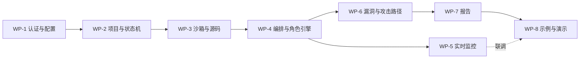

# 自动化安全评估系统 项目规划

## 0. 文档信息

| 项目 | 内容 |
| --- | --- |
| 文档名称 | 自动化安全评估系统 项目规划 |
| 文档版本 | v1.6 |
| 编写日期 | 2026-10-21 |
| 最后更新 | 2026-10-22（完整链路确认、WP-8 交付整理） |
| 依据文档 | 《PRD.md》v1.11 |
| 文档状态 | 已冻结 |
| 用途 | 按工作包拆分实施范围、顺序与验收，指导 vibe coding 分阶段推进 |

### 0.1 通用规则

1. **PRD 是唯一权威**。本文件只做拆分与实施规划，不复制枚举、表结构、接口字段、状态机与协议；凡有冲突，以 PRD 为准，并回头修正本文件。
2. **每个工作包是一个可独立开发和验收的垂直切片**，包含所需的前端、后端、数据与测试，不以"后端模块"为边界。
3. **按等级推进**：P0 为本包必须完成项；P1 列在本包内、允许在时间压力下整包裁掉；P2 不在本期规划内（见第 11 章）。
4. **完成定义（DoD）统一标准**：本包 P0 验收用例全部通过；接口行为与 PRD 7.2 一致；页面可实际操作；关键路径有自动化测试；无 S1/S2 缺陷；文档与实现同步更新。
5. 前置未完成时不得进入下游工作包；跨包契约变更需先改 PRD。

---

## 1. 工作包总览

| 编号 | 工作包 | 里程碑 | 依赖 | P0 验收用例 |
| --- | --- | --- | --- | --- |
| WP-1 | 认证与系统配置 | M1 | — | AC-01、AC-02、AC-16、AC-18、AC-24、AC-25 |
| WP-2 | 项目与状态机 | M1 | WP-1 | AC-03、AC-04、AC-13、AC-14、AC-15、AC-21 |
| WP-3 | 沙箱与源码准备 | M2 | WP-2 | AC-05、AC-20、AC-22、AC-23 |
| WP-4 | 编排与角色引擎 | M2 | WP-3 | AC-06、AC-12 |
| WP-5 | 实时监控 | M2 | WP-4 | AC-07、AC-17 |
| WP-6 | 漏洞与攻击路径 | M3 | WP-4 | AC-08、AC-09 |
| WP-7 | 报告 | M3 | WP-6 | AC-10、AC-11 |
| WP-8 | 示例项目与演示链路 | M4 | WP-7 | AC-19（含全量回归） |

依赖关系：

### 1.1 前端页面实施进度（2026-10-22）

> 本节只记录前端页面与交互层进度，**不代表对应工作包的后端接口与验收已完成**。

**总体**：9 个业务页面与 404 页面已实现，WP-5 监控、WP-6 漏洞/路径查询及 WP-7 报告预览/下载已接入真实后端；前端构建通过。实时通道断线自动重连，不再默认切换演示数据；演示通道需显式设置 `VITE_DEMO_MODE=1`。原型阶段截图记录保留，本轮浏览器目视检查未完成。

| 页面 | 路由 | 前端状态 | 数据来源 |
| --- | --- | --- | --- |
| 登录页 | `/login` | 已完成 | 真实接口（初始化 / 登录 / 登录态） |
| 项目列表页 | `/projects` | 已完成 | 真实接口 |
| 项目创建页 | `/projects/new` | 已完成 | 真实接口 |
| 项目详情页 | `/projects/:id` | 已完成 | 真实接口 + 演示动态回退 |
| 实时监控页 | `/projects/:id/monitor` | 已实现 | 真实 WS、历史查询、周期资源采样 |
| 漏洞列表页 | `/projects/:id/vulnerabilities` | 已实现（含详情抽屉） | 真实查询、筛选、分页与增量通知 |
| 攻击路径页 | `/projects/:id/attack-paths` | 已实现（含步骤时间线） | 真实列表/详情、分页与未验证节点标注 |
| 报告页 | `/projects/:id/report` | 已实现（目录 / 预览 / 下载 / 未生成态 / 历史轮次） | 真实接口、报告就绪事件；本轮无报告时不回退旧轮次 |
| 系统配置页 | `/settings` | 已实现 4 个 Tab | 全部接入真实接口 |
| 404 页面 | `*` | 已完成 | — |

**公共前端能力**：`AppLayout`（侧边栏 + 顶栏）、`ProjectHeader`（轮次选择 + 项目内 Tab）、统一设计令牌与响应式样式、内置 SVG 图标、确认弹窗/抽屉/空态/骨架屏、`useProjectStream`（snapshot、8 类消息、ping/pong、指数退避重连）、`loadWithDemo` 演示回退开关。

**交付补记（2026-10-22）**：两个内置 Flask 示例、完整演示脚本与交付文档已具备，用户已确认项目完整运行成功；已有真实演示摘要见 `docs/交付说明.md`。历史各轮页面目视限制按原记录保留，不将本次文件整理计作重新执行页面验收。

---

## 2. WP-1 认证与系统配置（M1）

**目标**：系统可初始化、登录、管理用户、持久化配置，并具备模型连接测试能力；后续所有工作包依赖本包提供的鉴权与配置读取。

**上游依赖**：无。

**PRD 引用**：3.1、3.2、5.1、5.10、6.1、6.2（Tab 1/2）、7.1、7.2、8.2（`users`、`user_sessions`、`system_configs`）、15.9、附录 E。

**接口与数据表**

- 接口：`POST /api/system/init`、`GET /api/system/status`、`GET /api/system/health`、`POST /api/system/login`、`POST /api/system/logout`、`GET/POST /api/system/users`、`PATCH/DELETE /api/system/users/{id}`、`GET/PUT /api/system/config`、`POST /api/system/config/test-llm`
- 表：`users`、`user_sessions`、`system_configs`

**P0 交付项**

- [x] 数据库初始化脚本（幂等）与默认配置种子数据（`db/init.sh` + 启动时补齐）
- [x] 初始化接口：首个管理员创建；重复调用返回 409
- [x] 登录 / 退出：argon2 校验、JWT 签发、`HttpOnly; Secure; SameSite=Strict` Cookie、`user_sessions` 会话与撤销
- [x] 统一鉴权中间件：401 / 403 语义、管理员接口保护
- [x] 用户管理：创建普通用户、列表、启用/禁用
- [x] 系统配置读写：类型校验、范围校验、敏感项 AES-GCM 加密与掩码返回；`sandbox.allowed_source_root` 支持逗号分隔的多根目录（AC-27）
- [x] 模型连接测试接口与配置页「连接测试」按钮
- [x] 登录页（含未初始化引导）与系统配置页 Tab 1 / Tab 2
- [x] 关键操作审计日志写入系统级 `runtime_logs`

**P1 交付项**

- [x] F-AUTH-07 连续失败锁定
- [x] F-AUTH-08 禁用账号撤销全部会话（WebSocket 断开在 WP-5 接入）
- [x] F-AUTH-09 删除用户：禁止删除自己与唯一管理员，名下仍有项目时拒绝
- [x] 配置页 Tab 4 的前端骨架（资源与系统日志查询在 WP-5 接通；当前开发环境使用演示回退）

**实现状态（2026-10-21）**：后端接口与前端页面已完成，43 项自动化测试通过；开发库已完成初始化。AC-25 已通过真实 DeepSeek 探测（含工具调用），AC-26 由删除用户用例覆盖，AC-27 由多根目录用例覆盖。

**验收用例**：AC-01、AC-02、AC-16、AC-18、AC-24、AC-25。

**DoD**：管理员可完成初始化 → 登录 → 创建普通用户 → 修改配置 → 连接测试；普通用户无法访问任何管理员接口；配置中的密钥以掩码返回。

**风险**：本地 http 下 Cookie 不发送 → 依赖 `COOKIE_SECURE=false` 与 Vite 同源代理（附录 E.3）。

---

## 3. WP-2 项目与状态机（M1）

**目标**：项目全生命周期（创建、查询、启动、停止、删除）与状态机、`run_id` 规则、归属隔离落地；本包不包含真实执行。

**上游依赖**：WP-1。

**PRD 引用**：4.2、4.4、5.2、6.1、6.2（列表/创建/详情）、7.2、8.2（`projects`、`project_runs`）、8.3、8.4。

**接口与数据表**

- 接口：`GET/POST /api/projects`、`GET /api/projects/{id}`、`POST /api/projects/{id}/start`、`POST /api/projects/{id}/stop`、`DELETE /api/projects/{id}`
- 表：`projects`、`project_runs`（启动时创建）

**P0 交付项**

- [x] 创建项目：字段校验、同创建者重名校验、`source_type` 分支校验；`local_path` 支持多根目录白名单
- [x] 项目列表：状态/关键字筛选、分页、最近启动/完成时间
- [x] 项目详情：基本信息、`current_run_id`、历史轮次切换骨架
- [x] 状态机：`created/running/completed/failed/stopped` 转换与 409 规则
- [x] `run_id` 递增与 `project_runs` 记录；查询默认按 `current_run_id` 过滤
- [x] 停止接口幂等语义
- [x] 删除项目：目录清理流程、`cleanup_pending`、级联删除顺序、二次确认
- [x] 权限隔离：普通用户仅见本人项目
- [x] 项目列表 / 创建 / 详情三个页面

**P1 交付项**

- [x] 空态与错误提示完善（F-PROJ-10）
- [x] `cleanup_pending` 项目的管理员重试入口（页面已在「隔离环境维护」Tab 呈现；sandbox 列表接口在 WP-3 接入）

**实现状态（2026-10-21）**：后端接口、状态机、删除清理与三个页面已完成；AC-13 / AC-14 / AC-15 / AC-21 由自动化测试覆盖。启动目前只完成校验、状态与轮次记录，真实执行在 WP-3 / WP-4 接入。

**验收用例**：AC-03、AC-04、AC-13、AC-14、AC-15、AC-21。

**DoD**：项目 CRUD 与状态流转可独立演示；删除失败可复现并可重试；越权访问返回 403。

**说明**：M1 阶段 `start` 只完成校验与状态记录，真实源码准备与执行在 WP-3 / WP-4 接入；AC-05 与 AC-12 在 M2 验收。

---

## 4. WP-3 沙箱与源码准备（M2）

**目标**：源码接入与隔离环境全生命周期可用；Docker Engine 运行于虚拟机，后端经 SSH 隧道连接并同步源码与工作区，为编排提供干净的 `/src` 与可写 `/workspace`。

**上游依赖**：WP-2；环境前置：Docker API 隧道可达、Docker 已安装。

**PRD 引用**：4.3（强制规则 1、7）、4.4、5.4、5.2（F-PROJ-02）、8.3、9.2、15.6、15.7、附录 E。

**接口与数据表**

- 接口：`POST /api/projects/{id}/start`（源码准备与容器创建部分）、`GET /api/system/sandboxes`、`DELETE /api/system/sandboxes/{id}`（P1）
- 表：`projects.sandbox_id`、`project_runs.source_revision/source_fingerprint/source_fingerprint_after`

**P0 交付项**

- [x] 沙箱镜像构建脚本与镜像（15.7）
- [x] SSH 隧道与远程 Docker 连接（`DOCKER_HOST=tcp://127.0.0.1:2375`）；连接失败返回 50002，不回退本机 Docker
- [x] 源码准备：`local_path` 白名单 + `realpath` 校验；`git_repo` 主机白名单、DNS/IP 校验与固定、重定向禁用、SSH 主机密钥校验
- [x] 源码规模校验（体积 / 文件数）与超限提示
- [x] 源码经 tar 流通过 Docker API 上传至命名卷 `sec-eval-src-{project_id}`
- [x] 本轮 Git commit 与源码 SHA-256 指纹记录
- [x] 容器创建/启动/停止/销毁，安全参数按 15.6 固定
- [x] 源码卷 `:ro` 挂载 `/src`、工作区卷 `:rw` 挂载 `/workspace`；helper 容器调整属主；卷创建与清理通过 Docker API
- [x] 容器异常失败/停止保留、重启先销毁旧容器的生命周期
- [x] 资源采样所需的容器统计读取能力

**P1 交付项**

- [x] 环境维护 Tab 的前端页面：容器列表、强制销毁、残留目录清理入口（后端接口已接入）
- [x] `sandbox.network_enabled` 开关生效
- [x] 容器创建/启动/销毁失败自动重试 3 次

**实现状态（2026-10-22）**：后端沙箱模块、源码准备、命名卷上传与容器生命周期已完成；`SANDBOX_INTEGRATION=1` 的实机用例验证了只读 `/src`、可写 `/workspace`、uid 1001 与清理流程。AC-20 / AC-22 已覆盖；AC-23 的报告前和发布前指纹复核已在 WP-7 接入；启动后的阶段执行在 WP-4 接入。

**验收用例**：AC-05、AC-20、AC-22、AC-23。

**DoD**：可用白名单内本地源码与合法 Git 仓库分别启动到"环境就绪"，源码与工作区正确落在命名卷；越界路径、非法主机、超限源码被拒绝；容器内 `/src` 不可写；隧道断开时返回 50002 且不产生残留容器；完成与失败两条路径的容器状态符合 4.4。

**风险**：Git 拉取的 DNS/IP 固定实现复杂度高，需预留独立测试用例（AC-22）；SSH 隧道与远端同步是新增链路，需覆盖上传中断、磁盘不足与清理失败的测试。

---

## 5. WP-4 编排与角色引擎（M2）

**目标**：五个阶段按顺序推进，6 类角色通过工具读取源码、执行命令并产出结构化结果；停止、超时、重试与崩溃恢复可用。

**上游依赖**：WP-3。

**PRD 引用**：4.3、5.3、5.5、5.5.1、7.2（stages / workers / stop）、8.2（`runtime_stages`、`worker_tasks`、`chat_messages`、`runtime_logs`）、15.1 ~ 15.5、附录 D。

**接口与数据表**

- 接口：`POST /api/projects/{id}/start`（编排部分）、`POST /api/projects/{id}/stop`、`GET /api/projects/{id}/stages`、`GET /api/projects/{id}/workers`
- 表：`runtime_stages`、`worker_tasks`、`chat_messages`、`runtime_logs`、`resource_usages`

**P0 交付项**

- [x] `RunManager` 与进程内 asyncio 编排（15.5），数据库为唯一状态源
- [x] 阶段推进与门禁：严格顺序、失败阻断、阶段/角色超时
- [x] 角色 agent 循环与 4 个工具（15.1、15.2）；远程模式下工具在容器内通过 `docker exec` 执行，工具调用留痕
- [x] 6 类角色提示词与阶段-角色串行顺序
- [x] 阶段 1 / 2 的 Schema 校验与重试（附录 D5、D1）；结构化落库
- [x] 阶段 3 / 4 在 `LLM_MOCK` 下的固定响应跑通，并完成 `vulnerabilities` / `attack_paths` / `reports` 的基础写入骨架（真实业务逻辑在 WP-6 / WP-7）
- [x] `worker_tasks` 全字段落库（含 `retry_count`、`error_message`）
- [x] 停止响应 $\le 5\text{ s}$、幂等语义
- [x] `LLM_MOCK=1` 固定响应模式
- [x] 服务重启恢复：残留 `running` 置 `failed`

**P1 交付项**

- [x] 最大并发项目数限制（429）
- [x] 阶段超时错误信息细化到具体角色与轮次

**WP-4 验收时状态（2026-10-22）**：编排、角色循环、四工具、查询接口与生命周期控制已接入。真实 Docker + MOCK 五阶段十角色全部成功；真实模型已跑通 `environment_scan → code_analysis`，并确认四个原生工具均实际调用，之后通过停止链路主动结束。真实阶段 3 / 4 当时留待 WP-6 / WP-7，现已分别接入，详见后续工作包记录。WP-4 验收与复跑方式见 `docs/WP-4-验收.md`。

**验收用例**：AC-06（以 `LLM_MOCK` 全流程通过）、AC-12（AC-05 在本包完成端到端）。

**DoD**：使用 `LLM_MOCK` 跑通全部 5 个阶段，并用真实模型跑通 `environment_scan → code_analysis`；任一角色解析失败能正确阻断；停止后状态与数据符合 4.4。

**风险**：真实模型的工具调用遵循度不稳定 → 提示词与 Schema 需要固定样例，重试路径必须可测。

---

## 6. WP-5 实时监控（M2）

**目标**：监控页在任务运行中实时、稳定地展示阶段、角色、消息、日志与资源；断线可恢复。

**上游依赖**：WP-4。

**PRD 引用**：5.9、6.2（实时监控页）、6.3、7.2、7.3、8.2（`chat_messages`、`runtime_logs`、`resource_usages`）、15.5。

**接口与数据表**

- 接口：`WS /api/projects/{id}/stream`、`GET /api/projects/{id}/messages`、`GET /api/projects/{id}/logs`、`GET /api/projects/{id}/resources`、`GET /api/system/resources`、`GET /api/system/logs`（P1）
- 表：`chat_messages`、`runtime_logs`、`resource_usages`

**P0 交付项**

- [x] WebSocket 鉴权与关闭码语义（4401/4403/4404）
- [x] 首帧 `snapshot` 与 8 类业务增量消息（7.3）
- [x] `ping/pong` 心跳与两次无响应断开
- [x] 前端自动重连（指数退避，上限 30 s）与快照对齐
- [x] 资源采样协程与 CPU/内存/Token 曲线
- [x] 日志滚动、暂停、级别着色、阶段/角色筛选及历史查询
- [x] 监控页数据链路接入（真实协议端到端已验；页面目视检查未完成）

**实现状态（2026-10-22）**：事务提交后发布事件，接入持续会话复核、慢连接恢复、周期资源采样、历史查询与管理端查询。真实 WebSocket + Docker + MOCK 连续监控 60 秒，断线 30 秒后以快照恢复，实测消息推送延迟 0.094 秒。浏览器目视检查未完成。

**P1 交付项**

- [x] 日志与资源保留期清理（默认 30 天）
- [x] 管理端全系统资源概览与系统日志页
- [x] 日志批量推送（100 ms 窗口）与前端虚拟滚动

**验收用例**：AC-07、AC-17。

**WP-7 前置复核（2026-10-22）**：启用 `SANDBOX_INTEGRATION=1` 完整回归，104 passed、无跳过；Ruff、前端 lint / build 均通过（lint 保留既有警告）。WP-5 / WP-6 自动化与实机数据链路前置通过，允许推进 WP-7；页面目视验收限制仍保留。

**DoD**：运行中刷新页面可恢复完整状态；断网 30 s 恢复后无重复与错乱；推送延迟满足 $\le 1\text{ s}$。

---

## 7. WP-6 漏洞与攻击路径（M3）

**目标**：漏洞从候选到验证结果全程可回溯并展示；攻击路径按利用顺序串联并可查看。

**上游依赖**：WP-4（可与 WP-5 并行）。

**PRD 引用**：5.6、5.7、6.2（漏洞列表 / 攻击路径页）、7.2、8.2（`vulnerabilities`、`attack_paths`、`attack_path_items`）、15.3、附录 D2/D3。

**接口与数据表**

- 接口：`GET /api/projects/{id}/vulnerabilities`、`GET /api/projects/{id}/vulnerabilities/{vuln_id}`、`GET /api/projects/{id}/attack-paths`、`GET /api/projects/{id}/attack-paths/{path_id}`
- 表：`vulnerabilities`、`attack_paths`、`attack_path_items`

**P0 交付项**

- [x] 阶段 2 落库规则定稿：编号 `VULN-{序号:03d}` 与候选漏洞写入
- [x] 阶段 3 真实角色逻辑：附录 D2 / D3 提示词、验证规则、攻击路径串联与 `step_order` 重排
- [x] 阶段 3 验证结论落库：`verify_status`、影响、触发条件、证据、复现步骤、验证代码、`cvss_score`
- [x] 路径 ≥2 步与轮次一致性校验、漏洞删除级联
- [x] 漏洞列表与详情抽屉、攻击路径页接入真实查询
- [x] `vulnerability_found` 推送（页面侧消费，更新不重复计数）

**P1 交付项**

- [x] 去重合并（`file_path + vuln_type`）
- [x] 风险等级 / 验证状态统计
- [x] 路径中未验证漏洞标注

**实现状态（2026-10-22）**：真实模型与 Docker 已跑通前三阶段；隔离验收样本产出 3 条已验证漏洞、2 条不少于两步的路径，四种原生工具均实际调用。进入 WP-7 前由脚本主动停止，不将报告占位当作成功。字段兼容迁移、权限/轮次隔离、去重、CVSS 边界、无漏洞/无路径及级联删除已有自动化验证。

**验收用例**：AC-08、AC-09。

**DoD**：示例项目可产出 ≥2 条可验证漏洞与 ≥1 条 ≥2 步路径；详情五要素齐全；跨轮次查询互不污染。

---

## 8. WP-7 报告（M3）

**目标**：每轮生成可预览、可下载的 Markdown / HTML 报告，内容与落库数据一致。

**上游依赖**：WP-6。

**PRD 引用**：5.8、6.2（报告页）、7.2、8.2（`reports`）、15.8、附录 B。

**接口与数据表**

- 接口：`GET /api/projects/{id}/report`、`GET /api/projects/{id}/report/download`
- 表：`reports`

**P0 交付项**

- [x] 阶段 4 真实角色逻辑：`report_writer` 提示词与 Markdown 生成（附录 D4，替换 WP-4 的骨架实现）
- [x] 六章节结构校验与失败重试
- [x] 服务端渲染 HTML + 白名单消毒
- [x] 数据库与磁盘双写：`report-run-{run_id}.md/.html` 与基准路径
- [x] 报告预览、章节导航、下载入口（真实接口与文件已接入；页面目视检查未完成）
- [x] 无漏洞 / 无路径场景兜底文本
- [x] `report_ready` 推送（提交后发布、页面侧消费）

**P1 交付项**

- [x] 历史轮次报告切换

**实现状态（2026-10-22）**：有漏洞与无漏洞标准库样本均通过真实 Docker / 模型五阶段、十角色及正常销毁；有漏洞样本产出 2 条 verified 漏洞、1 条多步路径。两类报告的 Markdown / HTML 文件与数据库逐字节一致。结构修复、查询下载、权限、轮次、HTML 消毒、文件写入回滚、重复保存及源码变化已纳入自动化测试；最终检查结果与限制见 `docs/WP-7-验收.md`。浏览器目视验收仍未完成，不能将构建通过等同于页面验收。

**最终回归**：`SANDBOX_INTEGRATION=1` 完整测试 **122 passed、无跳过**（427.30 秒）；Ruff、前端 lint / build 通过，lint 有 11 条既有警告。WP-7 功能、自动化和真实模型数据链路通过，页面目视验收待补；下一工作包为 WP-8。

**验收用例**：AC-10、AC-11。

**DoD**：报告六章节齐全；`.md` 与 `.html` 内容一致；下载可用；干净项目不报错。

---

## 9. WP-8 示例项目与演示链路（M4）

**目标**：交付可重复执行的完整演示，覆盖从接入到报告的端到端链路。

**上游依赖**：WP-7（含 WP-5 联调）。

**PRD 引用**：11、15.7、AC-19、附录 B。

**交付项**

- [x] `data/allowed_sources/demo-app/`：Flask 示例应用（4 个漏洞 + 1 条至少 3 步的攻击链）
- [x] `data/allowed_sources/demo-clean/`：无漏洞对照项目
- [x] 沙箱镜像最终版（含示例项目运行依赖）
- [x] 演示脚本：`scripts/verify-demo.py`；操作步骤与预期输出见 `docs/交付说明.md`
- [ ] 全量验收回归（AC-01 ~ AC-27）
- [x] 接口说明、部署说明、数据库初始化说明的最终校对

**交付记录（2026-10-22）**：用户确认完整运行成功；本地真实演示摘要记录两个样本均 completed、报告生成成功、源码未变，详见 `docs/交付说明.md`。保留全量 AC 回归待逐项核对的状态，不以一次完整运行代替所有验收项；本次未重新调用付费模型。

**验收用例**：AC-11、AC-19，以及全量回归。

**DoD**：在干净环境按演示脚本从零走完，全程无人工干预；所有 P0 验收用例通过；交付物齐套。

---

## 10. 横切事项（所有工作包共同遵守）

| 事项 | 要求 | 主要归属 |
| --- | --- | --- |
| 统一响应与错误码 | 按 PRD 7.1，接口与页面错误提示一致 | WP-1 定义，全包使用 |
| 鉴权与归属校验 | 所有项目级 HTTP / WS 接口做归属校验 | WP-1 提供，全包使用 |
| 时间与分页 | ISO 8601、前端本地时区、默认每页 20 条 | 全包 |
| 审计与运行日志 | 关键操作写系统级 `runtime_logs` | WP-1 起 |
| 配置读取 | 启动任务时读取 `system_configs`，运行中变更不生效 | WP-3 / WP-4 |
| 远程 Docker 与卷同步 | 隧道保持运行；卷名只用数字 `project_id` / `run_id` 拼接；失败返回 50002 | WP-3 起 |
| 前端壳 | 路由、布局、鉴权守卫、加载/空态组件 | WP-1 |
| 测试基线 | pytest + vitest；`LLM_MOCK` 覆盖编排链路 | WP-1 起逐包补充 |
| 文档同步 | 接口或表结构变化先改 PRD 再改代码 | 全包 |

---

## 11. 本期不做（P2 及范围外）

- 报告 PDF 导出、移动端、浏览器插件；
- 多租户、组织架构、细粒度 RBAC；
- 漏洞库同步、CVE 情报订阅、CI/CD 平台集成；
- 水平扩展与多实例任务接管；
- 同阶段角色并行执行（本期固定串行）；
- 源码在线编辑、自动修复与提交。

---

## 12. 实施顺序与里程碑出口

| 里程碑 | 工作包 | 出口标准 |
| --- | --- | --- |
| M1 | WP-1、WP-2 | AC-01 ~ AC-04、AC-13 ~ AC-16、AC-18、AC-21、AC-24、AC-25 通过 |
| M2 | WP-3、WP-4、WP-5 | AC-05 ~ AC-07、AC-12、AC-17、AC-20、AC-22、AC-23 通过 |
| M3 | WP-6、WP-7 | AC-08 ~ AC-11 通过 |
| M4 | WP-8 | AC-19 通过，全量回归通过，交付物齐套 |

**执行约定**

1. 开发前先启动 SSH 隧道（`scripts/docker-tunnel.sh`），再启动数据库、构建镜像与后端。
2. 每个工作包开工前先核对 PRD 对应章节与附录 D / E 是否存在未决问题，存在则先补 PRD。
3. 每个工作包完成后立即跑本包验收用例，不把验收推迟到里程碑末尾。
4. P1 项默认在 M2 / M3 内完成；若时间不足，按整包裁撤并在里程碑评审中记录。
5. 任何与 PRD 不一致的实现都视为缺陷，不以"代码先行"为由修改契约。
